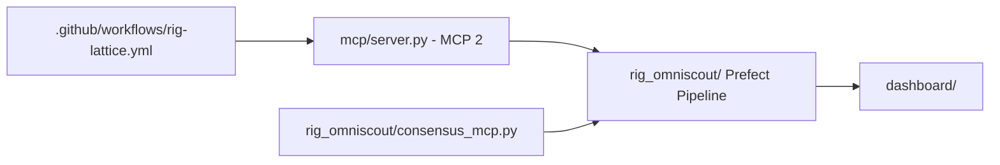

# Senior Architect Scan-Mode Note: `rig-omniscout-l2`

## 1. Synthesis (Reader Priority — Rule 19)
- **Primary Recommendation:** Add a dedicated tests/ suite to cover the Prefect pipeline and consensus_mcp.py, and reconcile the 3 dirty working-tree files.
- **MCP 2 (`2026-07-28`) Status:** `Strict MCP 2`
- **Critical / High Findings:**
  - **[High | Direct] Architecture Debt — Missing Test Suite:** No tests/ or test/ directory observed at repository root despite Prefect/Playwright pipeline complexity.

## 2. Pass Level, Scope & Promotion Gate
- **Pass Level:** `Scan Mode` (Rule 0 default)
- **Scope:** Repository `rig-omniscout-l2` at `/Users/rig128gb/Developer/rig-omniscout-l2` (`lang=Python`, `private=True`)
- **Focus/Full Promotion Trigger:** None (clean bounded Python package with rig_omniscout/, mcp/server.py, dashboard/, and rig-lattice.yml)
- **Architecture Areas Classified:** Backend/Pipeline (rig_omniscout/, Prefect >=3.0), Frontend (dashboard/), External Services/MCP (mcp/server.py, rig_omniscout/consensus_mcp.py), Infrastructure (.github/workflows/rig-lattice.yml, .rig/hooks/), Tests & Quality Gates (Not observed)

## 3. Evidence Checked & Skipped Areas
- **Evidence Files Checked (5):** `pyproject.toml`, `README.md`, `AGENTS.md`, `.github/workflows/rig-lattice.yml`, `mcp/server.py`
- **Root Entries:** 13 items | **Last Commit:** `c0291b1 2026-10-10 17:40:43 -0600 Merge pull request #1 from mrodgersjs-web/fix/rig-lattice-skip-until-published` | **Dirty Files:** `3`
- **Workflows:** `rig-lattice.yml`
- **MCP Files:** `mcp/server.py`
- **Skipped Areas (Scan-Mode Budget):** Deep line-by-line module bodies, runtime execution, and external service probes (not executed in read-only Scan Mode).

## 4. Confirmed Facts (`Direct`)
- Local checkout exists at `/Users/rig128gb/Developer/rig-omniscout-l2` with 13 top-level entries.
- Build/package manifests observed: `pyproject.toml`.
- Top-level code/tool directories observed: Not observed.
- Test directories observed: Not observed.
- MCP 2 (`2026-07-28`) status: `Strict MCP 2`.

## 5. Inferences & Assumptions (`Inferred` / `Assumed`)
- Inferred: rig_omniscout/consensus_mcp.py is an internal helper or legacy v1 server superseded by mcp/server.py (Verify first: Yes).

## 6. System Map (Mermaid)

## 7. Findings (Debt, Separation of Concerns, Convention Drift, Flow Conflicts)
- **[High | Direct] Architecture Debt — Missing Test Suite**
  - *Evidence:* No tests/ or test/ directory observed at repository root despite Prefect/Playwright pipeline complexity.
  - *Impact & Proposed Smallest Safe Correction:* Regressions in scraping or consensus scoring cannot be caught in CI; proposed: add pytest unit/contract tests under tests/.
- **[Medium | Inferred] Separation of Concerns — Dual MCP Modules**
  - *Evidence:* Both mcp/server.py (Strict MCP 2 2026-07-28) and rig_omniscout/consensus_mcp.py exist without explicit wiring in README.
  - *Impact & Proposed Smallest Safe Correction:* Potential confusion over which MCP entrypoint is canonical; proposed: document or route consensus_mcp through mcp/server.py.

## 8. Open Questions, Risks & Safe Next Actions
- **Open Questions:** Does rig_omniscout/consensus_mcp.py still serve live traffic or is mcp/server.py the sole entrypoint?
- **Risks:** Zero automated tests observed for nightly Playwright/Prefect runs.
- **Safe Next Actions (Proposed, Read-Only Until Approved):**
  - Inspect the 3 dirty files.
  - Add minimal pytest smoke tests for rig_omniscout and mcp/server.py.

## 9. Step-8 Validation Gate
1. **Claim traceability:** Yes — every file path, manifest, workflow, test directory, and MCP 2 status (`Strict MCP 2`) traces directly to inspected local files at `/Users/rig128gb/Developer/rig-omniscout-l2`; inferences are explicitly labeled `Inferred`.
2. **Scope alignment:** Yes — bounded strictly to Scan Mode (Rule 0) read-only inspection of this single repository; no files inside the target repository were modified.
3. **Handoff readiness:** Yes — open questions, risks, and proposed smallest safe next actions are explicitly listed (or marked `None identified`).
