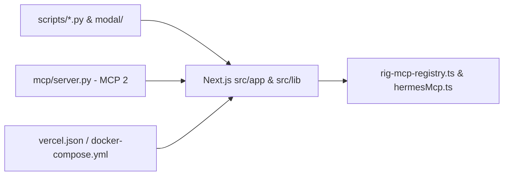

# Senior Architect Scan-Mode Note: `rig-os-agency`

## 1. Synthesis (Reader Priority — Rule 19)
- **Primary Recommendation:** Isolate root-level operational/OAuth scripts and markdown handoffs out of the Next.js root and add automated smoke/unit tests.
- **MCP 2 (`2026-07-28`) Status:** `Strict MCP 2`
- **Critical / High Findings:**
  - **[High | Direct] Architecture Debt — Multi-Runtime Root Clutter & Missing Tests:** 42 root files mix Next.js configs, PM2 (ecosystem.config.cjs), Docker, FIX_DASHBOARD.patch, raw data (company_export_raw_data.json), and 4 handoff docs; no tests/ directory exists.

## 2. Pass Level, Scope & Promotion Gate
- **Pass Level:** `Scan Mode` (Rule 0 default)
- **Scope:** Repository `rig-os-agency` at `/Users/rig128gb/Developer/rig-os-agency-mrodgersjs-web` (`lang=TypeScript`, `private=False`)
- **Focus/Full Promotion Trigger:** Focus Mode candidate — Next.js app (src/) coexists with 25+ root Python/JS ops scripts, Docker/Vercel configs, and 42 root files
- **Architecture Areas Classified:** Frontend/Backend (Next.js src/app, src/components, src/lib), AI/Background (scripts/1000x_engine.py, dept_bridge.py, modal/), External Services/MCP (mcp/server.py, src/lib/rig-mcp-registry.ts, hermesMcp.ts), Infrastructure (Dockerfile, docker-compose.yml, vercel.json, ecosystem.config.cjs, .github/workflows/), Tests & Quality Gates (Not observed)

## 3. Evidence Checked & Skipped Areas
- **Evidence Files Checked (13):** `package.json`, `docker-compose.yml`, `Dockerfile`, `vercel.json`, `tsconfig.json`, `README.md`, `AGENTS.md`, `CLAUDE.md`, `.github/workflows/rig-lattice.yml`, `.github/workflows/smoke.yml`, `mcp/server.py`, `src/`, `scripts/`
- **Root Entries:** 55 items | **Last Commit:** `a705f51 2026-10-29 20:42:14 -0500 build: declare nextjs framework to Vercel` | **Dirty Files:** `3`
- **Workflows:** `rig-lattice.yml`, `smoke.yml`
- **MCP Files:** `mcp/server.py`
- **Skipped Areas (Scan-Mode Budget):** Deep line-by-line module bodies, runtime execution, and external service probes (not executed in read-only Scan Mode).

## 4. Confirmed Facts (`Direct`)
- Local checkout exists at `/Users/rig128gb/Developer/rig-os-agency-mrodgersjs-web` with 55 top-level entries.
- Build/package manifests observed: `package.json`, `docker-compose.yml`, `Dockerfile`, `vercel.json`, `tsconfig.json`.
- Top-level code/tool directories observed: `src/`, `scripts/`.
- Test directories observed: Not observed.
- MCP 2 (`2026-07-28`) status: `Strict MCP 2`.

## 5. Inferences & Assumptions (`Inferred` / `Assumed`)
- Inferred: company_export_raw_data.json and FIX_DASHBOARD.patch are leftover local artifacts rather than runtime assets (Verify first: Yes).

## 6. System Map (Mermaid)

## 7. Findings (Debt, Separation of Concerns, Convention Drift, Flow Conflicts)
- **[High | Direct] Architecture Debt — Multi-Runtime Root Clutter & Missing Tests**
  - *Evidence:* 42 root files mix Next.js configs, PM2 (ecosystem.config.cjs), Docker, FIX_DASHBOARD.patch, raw data (company_export_raw_data.json), and 4 handoff docs; no tests/ directory exists.
  - *Impact & Proposed Smallest Safe Correction:* Blurs deployment boundary between Vercel Next.js and Python/Modal workers; proposed: move ops scripts/artifacts out of web root and add Vitest/Playwright smoke tests.
- **[Medium | Direct] Convention Drift — Dual Package Lockfiles**
  - *Evidence:* Both package-lock.json and pnpm-lock.yaml are present at root.
  - *Impact & Proposed Smallest Safe Correction:* Risk of dependency resolution drift across CI and local builds; proposed: standardize on one package manager lockfile.

## 8. Open Questions, Risks & Safe Next Actions
- **Open Questions:** Is Vercel (vercel.json) or Docker/PM2 (docker-compose.yml, ecosystem.config.cjs) the active production target?
- **Risks:** Dual lockfiles and untracked raw JSON export at root risk accidental bundling or stale builds.
- **Safe Next Actions (Proposed, Read-Only Until Approved):**
  - Remove or archive FIX_DASHBOARD.patch and company_export_raw_data.json.
  - Pick either pnpm-lock.yaml or package-lock.json and remove the other.

## 9. Step-8 Validation Gate
1. **Claim traceability:** Yes — every file path, manifest, workflow, test directory, and MCP 2 status (`Strict MCP 2`) traces directly to inspected local files at `/Users/rig128gb/Developer/rig-os-agency-mrodgersjs-web`; inferences are explicitly labeled `Inferred`.
2. **Scope alignment:** Yes — bounded strictly to Scan Mode (Rule 0) read-only inspection of this single repository; no files inside the target repository were modified.
3. **Handoff readiness:** Yes — open questions, risks, and proposed smallest safe next actions are explicitly listed (or marked `None identified`).
