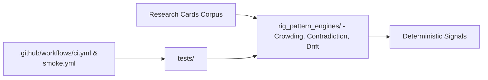

# Senior Architect Scan-Mode Note: `rig-pattern-engines`

## 1. Synthesis (Reader Priority — Rule 19)
- **Primary Recommendation:** Keep current clean offline library architecture; optionally expose via unified-engines-repo or add Strict MCP 2 wrapper only if standalone agent calls are needed.
- **MCP 2 (`2026-07-28`) Status:** `No MCP surface observed`
- **Critical / High Findings:** None identified.

## 2. Pass Level, Scope & Promotion Gate
- **Pass Level:** `Scan Mode` (Rule 0 default)
- **Scope:** Repository `rig-pattern-engines` at `/Users/rig128gb/Developer/rig-pattern-engines` (`lang=Python`, `private=False`)
- **Focus/Full Promotion Trigger:** None (clean, well-tested offline Python package; 0 dirty files)
- **Architecture Areas Classified:** Backend/Library (rig_pattern_engines/), Documentation (docs/architecture.md, docs/engines.md), Infrastructure (.github/workflows/ci.yml, smoke.yml), Tests & Quality Gates (tests/ with 5 test modules + fixtures)

## 3. Evidence Checked & Skipped Areas
- **Evidence Files Checked (5):** `pyproject.toml`, `README.md`, `.github/workflows/ci.yml`, `.github/workflows/smoke.yml`, `tests/`
- **Root Entries:** 17 items | **Last Commit:** `3f3cdff 2026-10-20 02:01:30 -0600 fix(ci): smoke installs the dev extra; test that workflow extras exist` | **Dirty Files:** `0`
- **Workflows:** `ci.yml`, `smoke.yml`
- **MCP Files:** Not observed
- **Skipped Areas (Scan-Mode Budget):** Deep line-by-line module bodies, runtime execution, and external service probes (not executed in read-only Scan Mode).

## 4. Confirmed Facts (`Direct`)
- Local checkout exists at `/Users/rig128gb/Developer/rig-pattern-engines` with 17 top-level entries.
- Build/package manifests observed: `pyproject.toml`.
- Top-level code/tool directories observed: Not observed.
- Test directories observed: `tests/`.
- MCP 2 (`2026-07-28`) status: `No MCP surface observed`.

## 5. Inferences & Assumptions (`Inferred` / `Assumed`)
- Inferred: Designed as a pure Python dependency consumed by unified-engines-repo rather than a standalone MCP server.

## 6. System Map (Mermaid)

## 7. Findings (Debt, Separation of Concerns, Convention Drift, Flow Conflicts)
- None identified.

## 8. Open Questions, Risks & Safe Next Actions
- **Open Questions:** None identified
- **Risks:** None identified
- **Safe Next Actions (Proposed, Read-Only Until Approved):**
  - Run pytest locally only when modifying engine logic.

## 9. Step-8 Validation Gate
1. **Claim traceability:** Yes — every file path, manifest, workflow, test directory, and MCP 2 status (`No MCP surface observed`) traces directly to inspected local files at `/Users/rig128gb/Developer/rig-pattern-engines`; inferences are explicitly labeled `Inferred`.
2. **Scope alignment:** Yes — bounded strictly to Scan Mode (Rule 0) read-only inspection of this single repository; no files inside the target repository were modified.
3. **Handoff readiness:** Yes — open questions, risks, and proposed smallest safe next actions are explicitly listed (or marked `None identified`).
