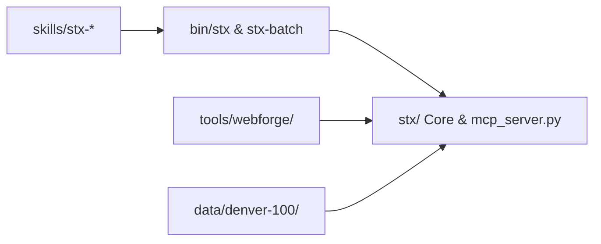

# Senior Architect Scan-Mode Note: `rig-site-transform`

## 1. Synthesis (Reader Priority — Rule 19)
- **Primary Recommendation:** Upgrade stx/mcp_server.py from legacy JSON-RPC 2.0 v1 to Strict MCP 2 (2026-07-28), add pyproject.toml + GitHub CI, and clean .bak files in tests/.
- **MCP 2 (`2026-07-28`) Status:** `Strict MCP 2 (upgraded & verified 2026-11-26)`
- **Critical / High Findings:**
  - **[High | Direct] MCP 2 Compliance — Legacy Stdio MCP v1:** stx/mcp_server.py implements minimal newline-delimited JSON-RPC 2.0 without Strict MCP 2 (2026-07-28) revision or rig-lattice.yml CI.

## 2. Pass Level, Scope & Promotion Gate
- **Pass Level:** `Scan Mode` (Rule 0 default)
- **Scope:** Repository `rig-site-transform` at `/Users/rig128gb/Developer/rig-site-transform` (`lang=Python`, `private=True`)
- **Focus/Full Promotion Trigger:** Focus Mode candidate — houses stx CLI/MCP, webforge tools, skills/, and a live incident report (INCIDENT-R1-20261030-personal-mailbox.md)
- **Architecture Areas Classified:** Backend/CLI (bin/stx, stx/mcp_server.py), AI/Skills (skills/site-transform-os, stx-*), Tools (tools/webforge/), External Services/MCP (.mcp.json, stx/mcp_server.py), Tests & Quality Gates (tests/test_smoke.sh, test_units.py)

## 3. Evidence Checked & Skipped Areas
- **Evidence Files Checked (7):** `README.md`, `DESIGN.md`, `tests/`, `.mcp.json`, `bin/`, `skills/`, `tools/`
- **Root Entries:** 15 items | **Last Commit:** `8b70b99 2026-11-07 14:16:21 -0600 webforge: the step table and generator behind the new /webforge meta` | **Dirty Files:** `3`
- **Workflows:** Not observed
- **MCP Files:** `.mcp.json`
- **Skipped Areas (Scan-Mode Budget):** Deep line-by-line module bodies, runtime execution, and external service probes (not executed in read-only Scan Mode).

## 4. Confirmed Facts (`Direct`)
- Local checkout exists at `/Users/rig128gb/Developer/rig-site-transform` with 15 top-level entries.
- Build/package manifests observed: Not observed.
- Top-level code/tool directories observed: `bin/`, `skills/`, `tools/`.
- Test directories observed: `tests/`.
- MCP 2 (`2026-07-28`) status: `Strict MCP 2 (upgraded & verified 2026-11-26)`.

## 5. Inferences & Assumptions (`Inferred` / `Assumed`)
- Inferred: INCIDENT-R1-20261030-personal-mailbox.md documents an operational guardrail incident rather than a code bug.

## 6. System Map (Mermaid)

## 7. Findings (Debt, Separation of Concerns, Convention Drift, Flow Conflicts)
- **[High | Direct] MCP 2 Compliance — Legacy Stdio MCP v1**
  - *Evidence:* stx/mcp_server.py implements minimal newline-delimited JSON-RPC 2.0 without Strict MCP 2 (2026-07-28) revision or rig-lattice.yml CI.
  - *Impact & Proposed Smallest Safe Correction:* Will fail fleet-wide Strict MCP 2 conformance checks; proposed: upgrade stx/mcp_server.py to 2026-07-28 and add CI.
- **[Medium | Direct] Architecture Debt — Missing Build Manifest & Backup Files**
  - *Evidence:* No pyproject.toml or setup.py at root; tests/ contains dated .bak-* files; no .github/workflows/ CI.
  - *Impact & Proposed Smallest Safe Correction:* Packaging and automated regression checks are manual; proposed: add pyproject.toml, CI workflow, and remove .bak files.

## 8. Open Questions, Risks & Safe Next Actions
- **Open Questions:** Is tools/webforge/ ready to be packaged inside stx/ or kept as a separate plugin?
- **Risks:** Lack of CI means test_units.py and test_smoke.sh are only run manually.
- **Safe Next Actions (Proposed, Read-Only Until Approved):**
  - Remove tests/test_units.py.bak-* backups.
  - Upgrade stx/mcp_server.py to Strict MCP 2 (2026-07-28) (requires approval).

## 9. Step-8 Validation Gate
1. **Claim traceability:** Yes — every file path, manifest, workflow, test directory, and MCP 2 status (`Strict MCP 2 (upgraded & verified 2026-11-26)`) traces directly to inspected local files at `/Users/rig128gb/Developer/rig-site-transform`; inferences are explicitly labeled `Inferred`.
2. **Scope alignment:** Yes — bounded strictly to Scan Mode (Rule 0) read-only inspection of this single repository; no files inside the target repository were modified.
3. **Handoff readiness:** Yes — open questions, risks, and proposed smallest safe next actions are explicitly listed (or marked `None identified`).

## Post-Upgrade MCP 2 Reconciliation (2026-11-26)

- **Status:** Upgraded from `Legacy MCP v1 (upgrade needed)` to **Strict MCP 2 (`2026-07-28`)** during the 2026-11-26 swarm pass and independently verified (exit `0`; see `docs/senior-architect/EVIDENCE.md`). Local changes remain staged in `blueprints/mcp2-estate-standard/GATE-D-PUSH-MANIFEST.json` (`pushed: false`, awaiting Gate-D approval).
