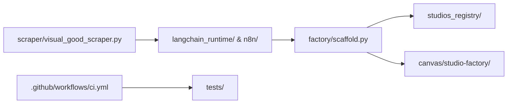

# Senior Architect Scan-Mode Note: `rig-studio-factory`

## 1. Synthesis (Reader Priority — Rule 19)
- **Primary Recommendation:** Add a root pyproject.toml to formalize Python dependencies and entrypoints for factory/, langchain_runtime/, and scraper/.
- **MCP 2 (`2026-07-28`) Status:** `No MCP surface observed`
- **Critical / High Findings:** None identified.

## 2. Pass Level, Scope & Promotion Gate
- **Pass Level:** `Scan Mode` (Rule 0 default)
- **Scope:** Repository `rig-studio-factory` at `/Users/rig128gb/Developer/rig-studio-factory` (`lang=Python`, `private=True`)
- **Focus/Full Promotion Trigger:** None (clean scaffold/factory repo with clear module boundaries and 0 dirty files)
- **Architecture Areas Classified:** Backend/Factory (factory/scaffold.py), AI/Orchestration (langchain_runtime/deterministic_pipeline.py, n8n/), Data/Scraping (scraper/visual_good_scraper.py, studios_registry/), Frontend/Canvas (canvas/studio-factory/), Infrastructure (.github/workflows/ci.yml), Tests & Quality Gates (tests/ with 3 test modules)

## 3. Evidence Checked & Skipped Areas
- **Evidence Files Checked (5):** `README.md`, `.github/workflows/ci.yml`, `tests/`, `scripts/`, `skills/`
- **Root Entries:** 14 items | **Last Commit:** `aa5d0b5 2026-11-22 14:32:44 -0700 feat(factory): wire production LangChain+n8n spine, upload visual What Good Looks Like exemplars, and add /repo-canvas-architect skill` | **Dirty Files:** `0`
- **Workflows:** `ci.yml`
- **MCP Files:** Not observed
- **Skipped Areas (Scan-Mode Budget):** Deep line-by-line module bodies, runtime execution, and external service probes (not executed in read-only Scan Mode).

## 4. Confirmed Facts (`Direct`)
- Local checkout exists at `/Users/rig128gb/Developer/rig-studio-factory` with 14 top-level entries.
- Build/package manifests observed: Not observed.
- Top-level code/tool directories observed: `scripts/`, `skills/`.
- Test directories observed: `tests/`.
- MCP 2 (`2026-07-28`) status: `No MCP surface observed`.

## 5. Inferences & Assumptions (`Inferred` / `Assumed`)
- Inferred: .github/workflows/ci.yml installs dependencies inline or uses stdlib/preinstalled runners.

## 6. System Map (Mermaid)

## 7. Findings (Debt, Separation of Concerns, Convention Drift, Flow Conflicts)
- **[Medium | Direct] Architecture Debt — Missing Root Python Manifest**
  - *Evidence:* No pyproject.toml or requirements.txt at root despite Python packages factory/, langchain_runtime/, scraper/, and pytest suite in tests/.
  - *Impact & Proposed Smallest Safe Correction:* Environment setup relies on implicit host Python packages; proposed: add pyproject.toml pinning dependencies.

## 8. Open Questions, Risks & Safe Next Actions
- **Open Questions:** None identified
- **Risks:** Unpinned Python dependencies could drift across local machines and CI.
- **Safe Next Actions (Proposed, Read-Only Until Approved):**
  - Add pyproject.toml with explicit runtime and test dependencies (requires approval).

## 9. Step-8 Validation Gate
1. **Claim traceability:** Yes — every file path, manifest, workflow, test directory, and MCP 2 status (`No MCP surface observed`) traces directly to inspected local files at `/Users/rig128gb/Developer/rig-studio-factory`; inferences are explicitly labeled `Inferred`.
2. **Scope alignment:** Yes — bounded strictly to Scan Mode (Rule 0) read-only inspection of this single repository; no files inside the target repository were modified.
3. **Handoff readiness:** Yes — open questions, risks, and proposed smallest safe next actions are explicitly listed (or marked `None identified`).
