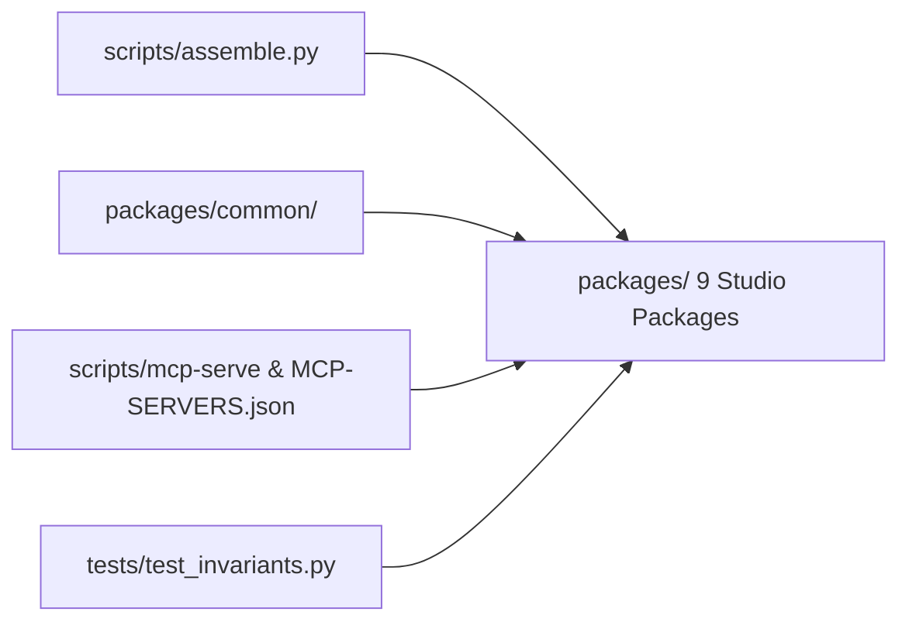

# Senior Architect Scan-Mode Note: `rig-studios`

## 1. Synthesis (Reader Priority — Rule 19)
- **Primary Recommendation:** Audit MCP-SERVERS.json and scripts/mcp-serve against Strict MCP 2 (2026-07-28) and add a local/CI workflow to run tests/test_invariants.py + gitleaks automatically.
- **MCP 2 (`2026-07-28`) Status:** `Legacy MCP v1 (upgrade needed)`
- **Critical / High Findings:**
  - **[High | Direct] MCP 2 Compliance — Mixed/Legacy MCP Server Registry:** MCP-SERVERS.json and submodule servers (e.g., rig-gtm-studio-v2/mcp/server.py) lack Strict MCP 2 (2026-07-28) verification at the monorepo level.

## 2. Pass Level, Scope & Promotion Gate
- **Pass Level:** `Scan Mode` (Rule 0 default)
- **Scope:** Repository `rig-studios` at `/Users/rig128gb/Developer/rig-studios` (`lang=Python`, `private=True`)
- **Focus/Full Promotion Trigger:** Focus Mode candidate — private monorepo aggregating 9 studio packages, git submodules, and 7 MCP servers
- **Architecture Areas Classified:** Shared Modules (packages/common/, packages/*-studio/), External Services/MCP (MCP-SERVERS.json, scripts/mcp-serve, scripts/mcp-setup), Infrastructure (scripts/assemble.py, .gitmodules, pytest.ini), Tests & Quality Gates (tests/test_invariants.py)

## 3. Evidence Checked & Skipped Areas
- **Evidence Files Checked (4):** `README.md`, `tests/`, `packages/`, `scripts/`
- **Root Entries:** 18 items | **Last Commit:** `bae8240f 2026-10-28 22:02:10 -0600 evidence: behavioral-science-studio imported (main 6bd42f6); gitleaks 0, invariants 66, offline bx tests, 7 MCP servers over ssh` | **Dirty Files:** `0`
- **Workflows:** Not observed
- **MCP Files:** Not observed
- **Skipped Areas (Scan-Mode Budget):** Deep line-by-line module bodies, runtime execution, and external service probes (not executed in read-only Scan Mode).

## 4. Confirmed Facts (`Direct`)
- Local checkout exists at `/Users/rig128gb/Developer/rig-studios` with 18 top-level entries.
- Build/package manifests observed: Not observed.
- Top-level code/tool directories observed: `packages/`, `scripts/`.
- Test directories observed: `tests/`.
- MCP 2 (`2026-07-28`) status: `Legacy MCP v1 (upgrade needed)`.

## 5. Inferences & Assumptions (`Inferred` / `Assumed`)
- Inferred: Private monorepo intentionally omits public CI or runs checks locally on rig256gb.

## 6. System Map (Mermaid)

## 7. Findings (Debt, Separation of Concerns, Convention Drift, Flow Conflicts)
- **[High | Direct] MCP 2 Compliance — Mixed/Legacy MCP Server Registry**
  - *Evidence:* MCP-SERVERS.json and submodule servers (e.g., rig-gtm-studio-v2/mcp/server.py) lack Strict MCP 2 (2026-07-28) verification at the monorepo level.
  - *Impact & Proposed Smallest Safe Correction:* Downstream MCP clients may encounter v1/v2 protocol mismatch; proposed: add MCP 2 conformance check to test_invariants.py.
- **[Medium | Direct] Architecture Debt — No Automated CI Workflow**
  - *Evidence:* No .github/workflows/ directory observed; invariant tests (66 invariants) and gitleaks rely on manual pre-push execution.
  - *Impact & Proposed Smallest Safe Correction:* Regressions or leaked secrets could slip in if manual checks are skipped; proposed: add GitHub Actions or pre-commit hook.

## 8. Open Questions, Risks & Safe Next Actions
- **Open Questions:** Which of the 7 servers in MCP-SERVERS.json are actively running over SSH vs. local stdio?
- **Risks:** Submodule drift between standalone studio repos and packages/*-studio/ imports.
- **Safe Next Actions (Proposed, Read-Only Until Approved):**
  - Run python3 -m pytest tests/test_invariants.py to verify current baseline.
  - Check MCP-SERVERS.json endpoints for 2026-07-28 compatibility.

## 9. Step-8 Validation Gate
1. **Claim traceability:** Yes — every file path, manifest, workflow, test directory, and MCP 2 status (`Legacy MCP v1 (upgrade needed)`) traces directly to inspected local files at `/Users/rig128gb/Developer/rig-studios`; inferences are explicitly labeled `Inferred`.
2. **Scope alignment:** Yes — bounded strictly to Scan Mode (Rule 0) read-only inspection of this single repository; no files inside the target repository were modified.
3. **Handoff readiness:** Yes — open questions, risks, and proposed smallest safe next actions are explicitly listed (or marked `None identified`).
