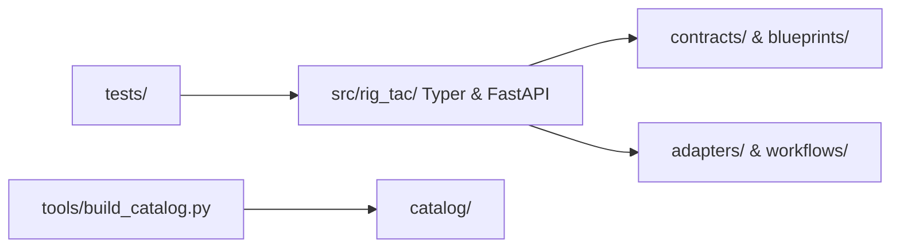

# Senior Architect Scan-Mode Note: `rig-tac-system`

## 1. Synthesis (Reader Priority — Rule 19)
- **Primary Recommendation:** Reconcile README status ('BUILD READY, NOT IMPLEMENTED') with the implemented src/rig_tac/ + tests/ suite, and triage the 18 uncommitted files.
- **MCP 2 (`2026-07-28`) Status:** `No MCP surface observed`
- **Critical / High Findings:** None identified.

## 2. Pass Level, Scope & Promotion Gate
- **Pass Level:** `Scan Mode` (Rule 0 default)
- **Scope:** Repository `rig-tac-system` at `/Users/rig128gb/Developer/rig-tac-system` (`lang=Python`, `private=True`)
- **Focus/Full Promotion Trigger:** Focus Mode candidate — active v0.1.0 control plane with 17 root dirs, 18 dirty files, and FastAPI/Typer/catalog subsystems
- **Architecture Areas Classified:** Backend/CLI (src/rig_tac/, FastAPI, Typer), AI/Agents (.claude/, .codex/, .omp/, adapters/, workflows/), Shared Modules (catalog/, contracts/, blueprints/, floorplan/), Tests & Quality Gates (tests/ with 11 test modules + fixtures)

## 3. Evidence Checked & Skipped Areas
- **Evidence Files Checked (6):** `pyproject.toml`, `README.md`, `AGENTS.md`, `tests/`, `src/`, `tools/`
- **Root Entries:** 26 items | **Last Commit:** `8f68508 2026-11-23 12:51:53 -0700 catalog: agency specialist checklists in 22 units; tac-stage-loop depends on loop-verify-retry` | **Dirty Files:** `18`
- **Workflows:** Not observed
- **MCP Files:** Not observed
- **Skipped Areas (Scan-Mode Budget):** Deep line-by-line module bodies, runtime execution, and external service probes (not executed in read-only Scan Mode).

## 4. Confirmed Facts (`Direct`)
- Local checkout exists at `/Users/rig128gb/Developer/rig-tac-system` with 26 top-level entries.
- Build/package manifests observed: `pyproject.toml`.
- Top-level code/tool directories observed: `src/`, `tools/`.
- Test directories observed: `tests/`.
- MCP 2 (`2026-07-28`) status: `No MCP surface observed`.

## 5. Inferences & Assumptions (`Inferred` / `Assumed`)
- Inferred: .tac-sources.local.json is machine-local configuration that should remain untracked.

## 6. System Map (Mermaid)

## 7. Findings (Debt, Separation of Concerns, Convention Drift, Flow Conflicts)
- **[Medium | Direct] Convention Drift — Stale README Status vs. Implementation**
  - *Evidence:* README.md still states 'Status at scaffold: BUILD READY, NOT IMPLEMENTED' while src/rig_tac/, tools/build_catalog.py, and 11 pytest modules are already present.
  - *Impact & Proposed Smallest Safe Correction:* Misleads agents and contributors about repo maturity; proposed: update README.md status to reflect v0.1.0 implementation.
- **[Medium | Direct] Architecture Debt — Uncommitted Changes & Missing CI**
  - *Evidence:* 18 dirty files in git status and no .github/workflows/ CI observed.
  - *Impact & Proposed Smallest Safe Correction:* Unverified local edits without automated CI gating; proposed: commit/clean dirty files and add pytest CI.

## 8. Open Questions, Risks & Safe Next Actions
- **Open Questions:** Should rig-tac-system expose a Strict MCP 2 (2026-07-28) server or remain CLI/FastAPI-only?
- **Risks:** 18 dirty files may contain unmerged catalog or egm_gate changes.
- **Safe Next Actions (Proposed, Read-Only Until Approved):**
  - Run pytest on tests/.
  - Update README.md status section (requires approval).

## 9. Step-8 Validation Gate
1. **Claim traceability:** Yes — every file path, manifest, workflow, test directory, and MCP 2 status (`No MCP surface observed`) traces directly to inspected local files at `/Users/rig128gb/Developer/rig-tac-system`; inferences are explicitly labeled `Inferred`.
2. **Scope alignment:** Yes — bounded strictly to Scan Mode (Rule 0) read-only inspection of this single repository; no files inside the target repository were modified.
3. **Handoff readiness:** Yes — open questions, risks, and proposed smallest safe next actions are explicitly listed (or marked `None identified`).
