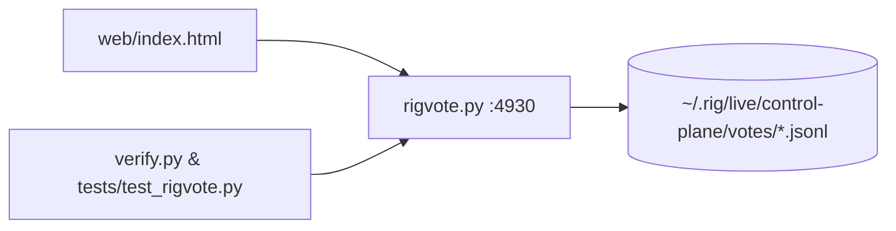

# Senior Architect Scan-Mode Note: `rig-vote`

## 1. Synthesis (Reader Priority — Rule 19)
- **Primary Recommendation:** Clean up the backup HTML file (web/index.html.bak-20261026-onetap) and keep the compact stdlib/JSONL design intact.
- **MCP 2 (`2026-07-28`) Status:** `No MCP surface observed`
- **Critical / High Findings:** None identified.

## 2. Pass Level, Scope & Promotion Gate
- **Pass Level:** `Scan Mode` (Rule 0 default)
- **Scope:** Repository `rig-vote` at `/Users/rig128gb/rig-builds/rig-vote` (`lang=Python`, `private=True`)
- **Focus/Full Promotion Trigger:** None (compact single-purpose service; 0 dirty files)
- **Architecture Areas Classified:** Backend (rigvote.py), Frontend (web/index.html), Infrastructure (launchd/, verify.py), Tests & Quality Gates (tests/test_rigvote.py, evidence/shots/)

## 3. Evidence Checked & Skipped Areas
- **Evidence Files Checked (4):** `README.md`, `tests/`, `web/`, `tools/`
- **Root Entries:** 12 items | **Last Commit:** `4a0d015 2026-11-09 18:02:32 -0600 Initial import: rig-vote (consolidation 2026-11-09)` | **Dirty Files:** `0`
- **Workflows:** Not observed
- **MCP Files:** Not observed
- **Skipped Areas (Scan-Mode Budget):** Deep line-by-line module bodies, runtime execution, and external service probes (not executed in read-only Scan Mode).

## 4. Confirmed Facts (`Direct`)
- Local checkout exists at `/Users/rig128gb/rig-builds/rig-vote` with 12 top-level entries.
- Build/package manifests observed: Not observed.
- Top-level code/tool directories observed: `web/`, `tools/`.
- Test directories observed: `tests/`.
- MCP 2 (`2026-07-28`) status: `No MCP surface observed`.

## 5. Inferences & Assumptions (`Inferred` / `Assumed`)
- Inferred: Runs under launchd com.rig.rigvote on Tailscale/loopback :4930 as part of RIG Soar.

## 6. System Map (Mermaid)

## 7. Findings (Debt, Separation of Concerns, Convention Drift, Flow Conflicts)
- **[Low | Direct] Convention Drift — Backup File Committed in web/**
  - *Evidence:* web/index.html.bak-20261026-onetap sits alongside web/index.html.
  - *Impact & Proposed Smallest Safe Correction:* Minor clutter in served web directory; proposed: remove .bak file from git.

## 8. Open Questions, Risks & Safe Next Actions
- **Open Questions:** None identified
- **Risks:** Append-only JSONL files in ~/.rig/live/control-plane/votes/ have no observed rotation/compaction in repo.
- **Safe Next Actions (Proposed, Read-Only Until Approved):**
  - Remove web/index.html.bak-20261026-onetap.
  - Run tests/test_rigvote.py to confirm green.

## 9. Step-8 Validation Gate
1. **Claim traceability:** Yes — every file path, manifest, workflow, test directory, and MCP 2 status (`No MCP surface observed`) traces directly to inspected local files at `/Users/rig128gb/rig-builds/rig-vote`; inferences are explicitly labeled `Inferred`.
2. **Scope alignment:** Yes — bounded strictly to Scan Mode (Rule 0) read-only inspection of this single repository; no files inside the target repository were modified.
3. **Handoff readiness:** Yes — open questions, risks, and proposed smallest safe next actions are explicitly listed (or marked `None identified`).
