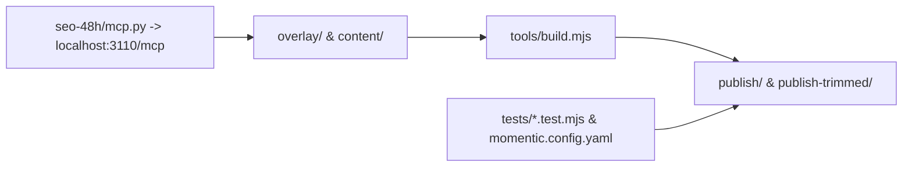

# Senior Architect Scan-Mode Note: `rig-website`

## 1. Synthesis (Reader Priority — Rule 19)
- **Primary Recommendation:** Triage the 66 dirty working-tree files and separate transient QA/report outputs (test-results/, jev-seo-reports/) from source/overlay files.
- **MCP 2 (`2026-07-28`) Status:** `No MCP surface observed`
- **Critical / High Findings:**
  - **[High | Direct] Architecture Debt — Large Uncommitted State & Artifact Mixing:** 66 dirty files in git status alongside multiple output/staging trees (publish/, publish-trimmed/, staging/, test-results/, jev-seo-reports/).

## 2. Pass Level, Scope & Promotion Gate
- **Pass Level:** `Scan Mode` (Rule 0 default)
- **Scope:** Repository `rig-website` at `/Users/rig128gb/Developer/rig-website` (`lang=HTML`, `private=True`)
- **Focus/Full Promotion Trigger:** Focus Mode candidate — 66 dirty files, mixed release overlay + SEO/measurement tools + momentic/Playwright QA
- **Architecture Areas Classified:** Frontend (web/, publish/, publish-trimmed/, staging/, alternatives-2026/), Backend/Tools (tools/*.mjs, seo-48h/mcp.py), Infrastructure (package.json, release-manifest.json, momentic.config.yaml), Tests & Quality Gates (tests/*.test.mjs, frontend-qa.cjs)

## 3. Evidence Checked & Skipped Areas
- **Evidence Files Checked (5):** `package.json`, `README.md`, `tests/`, `web/`, `tools/`
- **Root Entries:** 29 items | **Last Commit:** `0dd0ad9 2026-11-23 23:43:55 -0700 tools: fix-cta-swaps repairs swapped CTA href/label anchors (OpenSEO audit 7ac2cbd7: 14 broken internal links on 14 pages); with regression test` | **Dirty Files:** `66`
- **Workflows:** Not observed
- **MCP Files:** Not observed
- **Skipped Areas (Scan-Mode Budget):** Deep line-by-line module bodies, runtime execution, and external service probes (not executed in read-only Scan Mode).

## 4. Confirmed Facts (`Direct`)
- Local checkout exists at `/Users/rig128gb/Developer/rig-website` with 29 top-level entries.
- Build/package manifests observed: `package.json`.
- Top-level code/tool directories observed: `web/`, `tools/`.
- Test directories observed: `tests/`.
- MCP 2 (`2026-07-28`) status: `No MCP surface observed`.

## 5. Inferences & Assumptions (`Inferred` / `Assumed`)
- Inferred: Node 24.x build pipeline transforms legacy static HTML via tools/*-transform.mjs.

## 6. System Map (Mermaid)

## 7. Findings (Debt, Separation of Concerns, Convention Drift, Flow Conflicts)
- **[High | Direct] Architecture Debt — Large Uncommitted State & Artifact Mixing**
  - *Evidence:* 66 dirty files in git status alongside multiple output/staging trees (publish/, publish-trimmed/, staging/, test-results/, jev-seo-reports/).
  - *Impact & Proposed Smallest Safe Correction:* High risk of deploying unreviewed or stale static assets; proposed: gitignore generated reports/test-results and commit clean overlay changes.
- **[Low | Direct] Separation of Concerns — External MCP Client Coupling**
  - *Evidence:* seo-48h/mcp.py hardcodes HTTP calls to http://localhost:3110/mcp.
  - *Impact & Proposed Smallest Safe Correction:* Fails if local OpenSEO server on :3110 is down or moved; proposed: parameterize endpoint via env var.

## 8. Open Questions, Risks & Safe Next Actions
- **Open Questions:** Which directory (publish/ or publish-trimmed/) is deployed to production?
- **Risks:** 66 dirty files make rollback or clean release verification difficult.
- **Safe Next Actions (Proposed, Read-Only Until Approved):**
  - Run node --test tests/*.test.mjs.
  - Audit git status to separate generated QA artifacts from source edits.

## 9. Step-8 Validation Gate
1. **Claim traceability:** Yes — every file path, manifest, workflow, test directory, and MCP 2 status (`No MCP surface observed`) traces directly to inspected local files at `/Users/rig128gb/Developer/rig-website`; inferences are explicitly labeled `Inferred`.
2. **Scope alignment:** Yes — bounded strictly to Scan Mode (Rule 0) read-only inspection of this single repository; no files inside the target repository were modified.
3. **Handoff readiness:** Yes — open questions, risks, and proposed smallest safe next actions are explicitly listed (or marked `None identified`).
