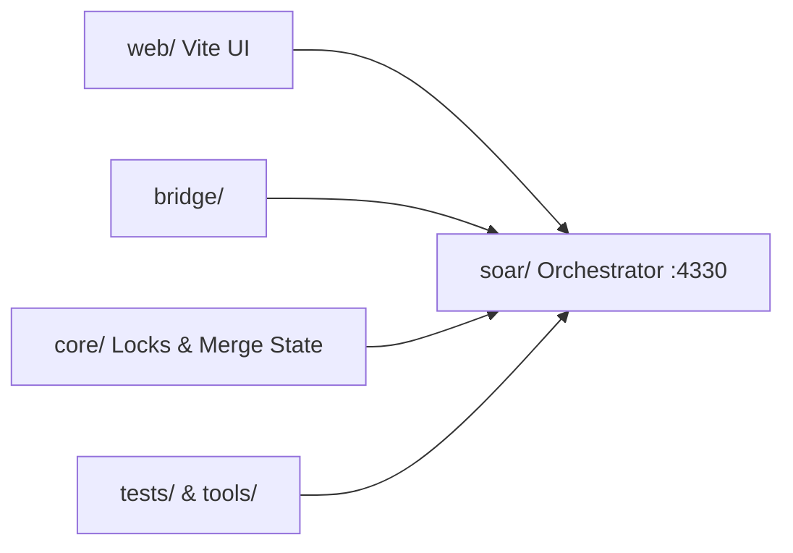

# Senior Architect Scan-Mode Note: `rigdots-soar`

## 1. Synthesis (Reader Priority — Rule 19)
- **Primary Recommendation:** Archive or prune the 25+ dated .bak-* files in root and tests/ to restore repository clarity.
- **MCP 2 (`2026-07-28`) Status:** `No MCP surface observed`
- **Critical / High Findings:** None identified.

## 2. Pass Level, Scope & Promotion Gate
- **Pass Level:** `Scan Mode` (Rule 0 default)
- **Scope:** Repository `rigdots-soar` at `/Users/rig128gb/rig-builds/rigdots-soar` (`lang=Python`, `private=True`)
- **Focus/Full Promotion Trigger:** Focus Mode candidate — 38 root files with 20+ .bak-* files from 2026-10-26..28 merges, plus bridge/, core/, soar/, web/
- **Architecture Areas Classified:** Frontend (web/ React/Vite), Backend (soar/, bridge/, core/), Infrastructure (launchd/, graft/), Tests & Quality Gates (tests/ with 9 test files + fakes)

## 3. Evidence Checked & Skipped Areas
- **Evidence Files Checked (5):** `README.md`, `tests/`, `core/`, `web/`, `tools/`
- **Root Entries:** 48 items | **Last Commit:** `92bca1d 2026-11-09 18:03:21 -0600 Initial import: rigdots-soar (consolidation 2026-11-09)` | **Dirty Files:** `0`
- **Workflows:** Not observed
- **MCP Files:** Not observed
- **Skipped Areas (Scan-Mode Budget):** Deep line-by-line module bodies, runtime execution, and external service probes (not executed in read-only Scan Mode).

## 4. Confirmed Facts (`Direct`)
- Local checkout exists at `/Users/rig128gb/rig-builds/rigdots-soar` with 48 top-level entries.
- Build/package manifests observed: Not observed.
- Top-level code/tool directories observed: `core/`, `web/`, `tools/`.
- Test directories observed: `tests/`.
- MCP 2 (`2026-07-28`) status: `No MCP surface observed`.

## 5. Inferences & Assumptions (`Inferred` / `Assumed`)
- Inferred: Snapshot repo from the 2026-11-09 consolidation pointing to live runtime on rig256gb ~/Developer/rig-soar/app.

## 6. System Map (Mermaid)

## 7. Findings (Debt, Separation of Concerns, Convention Drift, Flow Conflicts)
- **[Medium | Direct] Architecture Debt — Consolidation Backup File Bloat**
  - *Evidence:* Root contains 38 files of which >20 are dated .bak-* snapshots (INBOX.md.bak-*, MERGE-MAP.md.bak-*), plus .bak files in tests/ and tools/.
  - *Impact & Proposed Smallest Safe Correction:* Obscures current canonical docs (MERGE-MAP.md, INBOX.md, test_soar.py); proposed: remove .bak-* files since git history preserves them.

## 8. Open Questions, Risks & Safe Next Actions
- **Open Questions:** Is rigdots-soar an archival mirror of rig-soar/app or the active source of truth?
- **Risks:** Divergence between this consolidated repo and live launchd com.rig.rigsoar on rig256gb.
- **Safe Next Actions (Proposed, Read-Only Until Approved):**
  - Prune .bak-* files in a cleanup commit (requires approval).
  - Verify pytest passes on tests/.

## 9. Step-8 Validation Gate
1. **Claim traceability:** Yes — every file path, manifest, workflow, test directory, and MCP 2 status (`No MCP surface observed`) traces directly to inspected local files at `/Users/rig128gb/rig-builds/rigdots-soar`; inferences are explicitly labeled `Inferred`.
2. **Scope alignment:** Yes — bounded strictly to Scan Mode (Rule 0) read-only inspection of this single repository; no files inside the target repository were modified.
3. **Handoff readiness:** Yes — open questions, risks, and proposed smallest safe next actions are explicitly listed (or marked `None identified`).
