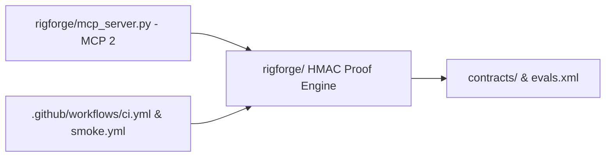

# Senior Architect Scan-Mode Note: `rigforge`

## 1. Synthesis (Reader Priority — Rule 19)
- **Primary Recommendation:** Maintain current clean architecture; verify rigforge/tests/ runs in ci.yml alongside scripts/smoke.sh.
- **MCP 2 (`2026-07-28`) Status:** `Strict MCP 2`
- **Critical / High Findings:** None identified.

## 2. Pass Level, Scope & Promotion Gate
- **Pass Level:** `Scan Mode` (Rule 0 default)
- **Scope:** Repository `rigforge` at `/Users/rig128gb/Developer/rigforge-deterministic-platform` (`lang=Python`, `private=False`)
- **Focus/Full Promotion Trigger:** None (clean, well-documented, 0 dirty files, CI + threat model + Strict MCP 2)
- **Architecture Areas Classified:** Backend/Library (rigforge/), Contracts (contracts/, evals.xml), External Services/MCP (rigforge/mcp_server.py), Infrastructure (.github/workflows/ci.yml, smoke.yml, scripts/smoke.sh), Tests & Quality Gates (rigforge/tests/test_mcp_server.py, .pre-commit-config.yaml)

## 3. Evidence Checked & Skipped Areas
- **Evidence Files Checked (6):** `pyproject.toml`, `README.md`, `AGENTS.md`, `.github/workflows/ci.yml`, `.github/workflows/smoke.yml`, `scripts/`
- **Root Entries:** 25 items | **Last Commit:** `f7cbd9d 2026-10-20 02:16:17 -0600 docs: restore the Claude Desktop mcpServers snippet in README` | **Dirty Files:** `0`
- **Workflows:** `ci.yml`, `smoke.yml`
- **MCP Files:** Not observed
- **Skipped Areas (Scan-Mode Budget):** Deep line-by-line module bodies, runtime execution, and external service probes (not executed in read-only Scan Mode).

## 4. Confirmed Facts (`Direct`)
- Local checkout exists at `/Users/rig128gb/Developer/rigforge-deterministic-platform` with 25 top-level entries.
- Build/package manifests observed: `pyproject.toml`.
- Top-level code/tool directories observed: `scripts/`.
- Test directories observed: Not observed.
- MCP 2 (`2026-07-28`) status: `Strict MCP 2`.

## 5. Inferences & Assumptions (`Inferred` / `Assumed`)
- Inferred: Production-ready public reference repo with MIT license, threat model, and Strict MCP 2 (2026-07-28) server.

## 6. System Map (Mermaid)

## 7. Findings (Debt, Separation of Concerns, Convention Drift, Flow Conflicts)
- **[Low | Direct] Convention Drift — Non-Standard Test Directory Location**
  - *Evidence:* Tests live inside rigforge/tests/ rather than top-level tests/ as in sibling RIG Python repos.
  - *Impact & Proposed Smallest Safe Correction:* Minor tooling inconsistency (pytest discovery still works if configured); proposed: keep as-is or document in CONTRIBUTING.md.

## 8. Open Questions, Risks & Safe Next Actions
- **Open Questions:** None identified
- **Risks:** None identified
- **Safe Next Actions (Proposed, Read-Only Until Approved):**
  - Run scripts/smoke.sh to confirm local parity with CI.

## 9. Step-8 Validation Gate
1. **Claim traceability:** Yes — every file path, manifest, workflow, test directory, and MCP 2 status (`Strict MCP 2`) traces directly to inspected local files at `/Users/rig128gb/Developer/rigforge-deterministic-platform`; inferences are explicitly labeled `Inferred`.
2. **Scope alignment:** Yes — bounded strictly to Scan Mode (Rule 0) read-only inspection of this single repository; no files inside the target repository were modified.
3. **Handoff readiness:** Yes — open questions, risks, and proposed smallest safe next actions are explicitly listed (or marked `None identified`).

## Post-Upgrade MCP 2 Reconciliation (2026-11-26)

- **Status:** Upgraded from `Strict MCP 2` to **Strict MCP 2 (`2026-07-28`)** during the 2026-11-26 swarm pass and independently verified (exit `0`; see `docs/senior-architect/EVIDENCE.md`). Local changes remain staged in `blueprints/mcp2-estate-standard/GATE-D-PUSH-MANIFEST.json` (`pushed: false`, awaiting Gate-D approval).
