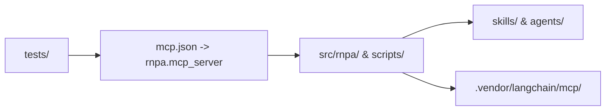

# Senior Architect Scan-Mode Note: `robonuggets-rpa`

## 1. Synthesis (Reader Priority — Rule 19)
- **Primary Recommendation:** Upgrade rnpa.mcp_server and mcp.json to Strict MCP 2 (2026-07-28), add .github/workflows/ CI, and verify .env is gitignored.
- **MCP 2 (`2026-07-28`) Status:** `Strict MCP 2 (upgraded & verified 2026-11-26)`
- **Critical / High Findings:**
  - **[High | Direct] MCP 2 Compliance — Legacy MCP v1 Contract:** mcp.json and tests/test_mcp_contract.py implement v1 initialize/tools/list/tools/call without Strict MCP 2 (2026-07-28) protocolVersion.

## 2. Pass Level, Scope & Promotion Gate
- **Pass Level:** `Scan Mode` (Rule 0 default)
- **Scope:** Repository `robonuggets-rpa` at `/Users/rig128gb/Developer/robonuggets-rpa` (`lang=Python`, `private=True`)
- **Focus/Full Promotion Trigger:** Focus Mode candidate — dual Python/Node project with .vendor/langchain/, blueprints/, 15+ test files, and Legacy MCP v1
- **Architecture Areas Classified:** Backend/CLI (src/rnpa/, scripts/), AI/Agents (agents/, skills/, .vendor/langchain/), Shared Modules (blueprints/rpa-pack/, seeds/), External Services/MCP (mcp.json, tests/test_mcp_contract.py), Tests & Quality Gates (tests/ with 15+ test modules)

## 3. Evidence Checked & Skipped Areas
- **Evidence Files Checked (12):** `package.json`, `pyproject.toml`, `.env.example`, `README.md`, `AGENTS.md`, `CLAUDE.md`, `tests/`, `mcp.json`, `src/`, `scripts/`, `agents/`, `skills/`
- **Root Entries:** 34 items | **Last Commit:** `e44959b 2026-11-24 18:36:34 -0700 docs(design): mark all 14 build tasks built` | **Dirty Files:** `0`
- **Workflows:** Not observed
- **MCP Files:** `mcp.json`
- **Skipped Areas (Scan-Mode Budget):** Deep line-by-line module bodies, runtime execution, and external service probes (not executed in read-only Scan Mode).

## 4. Confirmed Facts (`Direct`)
- Local checkout exists at `/Users/rig128gb/Developer/robonuggets-rpa` with 34 top-level entries.
- Build/package manifests observed: `package.json`, `pyproject.toml`, `.env.example`.
- Top-level code/tool directories observed: `src/`, `scripts/`, `agents/`, `skills/`.
- Test directories observed: `tests/`.
- MCP 2 (`2026-07-28`) status: `Strict MCP 2 (upgraded & verified 2026-11-26)`.

## 5. Inferences & Assumptions (`Inferred` / `Assumed`)
- Inferred: .env at root is local runtime config; .gitignore should keep it untracked (Verify first: Yes).

## 6. System Map (Mermaid)

## 7. Findings (Debt, Separation of Concerns, Convention Drift, Flow Conflicts)
- **[High | Direct] MCP 2 Compliance — Legacy MCP v1 Contract**
  - *Evidence:* mcp.json and tests/test_mcp_contract.py implement v1 initialize/tools/list/tools/call without Strict MCP 2 (2026-07-28) protocolVersion.
  - *Impact & Proposed Smallest Safe Correction:* Incompatible with Strict MCP 2 fleet gates; proposed: upgrade rnpa/mcp_server.py to 2026-07-28.
- **[Medium | Direct] Architecture Debt — Vendored LangChain & Missing CI**
  - *Evidence:* .vendor/langchain/ is committed directly and no .github/workflows/ CI exists despite comprehensive tests/.
  - *Impact & Proposed Smallest Safe Correction:* Vendored code drifts from upstream and tests are not gated on push; proposed: add CI workflow running pytest.

## 8. Open Questions, Risks & Safe Next Actions
- **Open Questions:** Is the Node package.json only for plugin/doc tooling or runtime execution?
- **Risks:** Presence of .env at root alongside .env.example requires secret-scan vigilance.
- **Safe Next Actions (Proposed, Read-Only Until Approved):**
  - Verify .env is ignored by git check-ignore .env.
  - Upgrade rnpa/mcp_server.py to Strict MCP 2 (requires approval).

## 9. Step-8 Validation Gate
1. **Claim traceability:** Yes — every file path, manifest, workflow, test directory, and MCP 2 status (`Strict MCP 2 (upgraded & verified 2026-11-26)`) traces directly to inspected local files at `/Users/rig128gb/Developer/robonuggets-rpa`; inferences are explicitly labeled `Inferred`.
2. **Scope alignment:** Yes — bounded strictly to Scan Mode (Rule 0) read-only inspection of this single repository; no files inside the target repository were modified.
3. **Handoff readiness:** Yes — open questions, risks, and proposed smallest safe next actions are explicitly listed (or marked `None identified`).

## Post-Upgrade MCP 2 Reconciliation (2026-11-26)

- **Status:** Upgraded from `Legacy MCP v1 (upgrade needed)` to **Strict MCP 2 (`2026-07-28`)** during the 2026-11-26 swarm pass and independently verified (exit `0`; see `docs/senior-architect/EVIDENCE.md`). Local changes remain staged in `blueprints/mcp2-estate-standard/GATE-D-PUSH-MANIFEST.json` (`pushed: false`, awaiting Gate-D approval).
