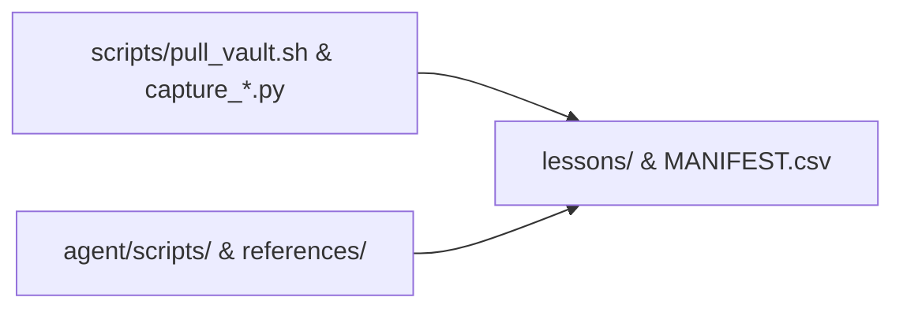

# Senior Architect Scan-Mode Note: `robonuggets-vault`

## 1. Synthesis (Reader Priority — Rule 19)
- **Primary Recommendation:** Keep repo strictly private/local-only as documented in README.md and add a basic manifest integrity test for MANIFEST.csv.
- **MCP 2 (`2026-07-28`) Status:** `No MCP surface observed`
- **Critical / High Findings:** None identified.

## 2. Pass Level, Scope & Promotion Gate
- **Pass Level:** `Scan Mode` (Rule 0 default)
- **Scope:** Repository `robonuggets-vault` at `/Users/rig128gb/rig-builds/robonuggets-vault` (`lang=Python`, `private=True`)
- **Focus/Full Promotion Trigger:** None (private local content vault + skill scripts; 0 dirty files)
- **Architecture Areas Classified:** Data/Corpus (lessons/, MANIFEST.csv, templates/), AI/Skills (agent/meta/, agent/references/, agent/scripts/), Infrastructure (scripts/pull_vault.sh, capture_*.py), Tests & Quality Gates (Not observed)

## 3. Evidence Checked & Skipped Areas
- **Evidence Files Checked (2):** `README.md`, `scripts/`
- **Root Entries:** 7 items | **Last Commit:** `0ac4efd 2026-11-19 12:14:37 -0600 Teach the agent which lessons have nothing in them, and keep the repo as the source of truth` | **Dirty Files:** `0`
- **Workflows:** Not observed
- **MCP Files:** Not observed
- **Skipped Areas (Scan-Mode Budget):** Deep line-by-line module bodies, runtime execution, and external service probes (not executed in read-only Scan Mode).

## 4. Confirmed Facts (`Direct`)
- Local checkout exists at `/Users/rig128gb/rig-builds/robonuggets-vault` with 7 top-level entries.
- Build/package manifests observed: Not observed.
- Top-level code/tool directories observed: `scripts/`.
- Test directories observed: Not observed.
- MCP 2 (`2026-07-28`) status: `No MCP surface observed`.

## 5. Inferences & Assumptions (`Inferred` / `Assumed`)
- Inferred: Read-only corpus consumed locally by robonuggets-rpa.

## 6. System Map (Mermaid)

## 7. Findings (Debt, Separation of Concerns, Convention Drift, Flow Conflicts)
- **[Low | Direct] Architecture Debt — No Automated Manifest Verification**
  - *Evidence:* MANIFEST.csv and 37 step skills in agent/ have no automated consistency test.
  - *Impact & Proposed Smallest Safe Correction:* Lesson/manifest drift goes unnoticed; proposed: add a lightweight Python check verifying MANIFEST.csv paths exist.

## 8. Open Questions, Risks & Safe Next Actions
- **Open Questions:** None identified
- **Risks:** Paid member content must never be pushed to a public remote (explicitly guarded in README.md).
- **Safe Next Actions (Proposed, Read-Only Until Approved):**
  - Confirm git remote visibility remains private.

## 9. Step-8 Validation Gate
1. **Claim traceability:** Yes — every file path, manifest, workflow, test directory, and MCP 2 status (`No MCP surface observed`) traces directly to inspected local files at `/Users/rig128gb/rig-builds/robonuggets-vault`; inferences are explicitly labeled `Inferred`.
2. **Scope alignment:** Yes — bounded strictly to Scan Mode (Rule 0) read-only inspection of this single repository; no files inside the target repository were modified.
3. **Handoff readiness:** Yes — open questions, risks, and proposed smallest safe next actions are explicitly listed (or marked `None identified`).
