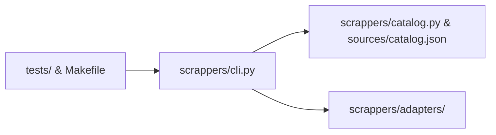

# Senior Architect Scan-Mode Note: `scrappers`

## 1. Synthesis (Reader Priority — Rule 19)
- **Primary Recommendation:** Add a GitHub Actions CI workflow running `make` (catalog validate + pytest + test_security.py) and resolve the 1 dirty file.
- **MCP 2 (`2026-07-28`) Status:** `No MCP surface observed`
- **Critical / High Findings:** None identified.

## 2. Pass Level, Scope & Promotion Gate
- **Pass Level:** `Scan Mode` (Rule 0 default)
- **Scope:** Repository `scrappers` at `/Users/rig128gb/Developer/scrapers` (`lang=Python`, `private=True`)
- **Focus/Full Promotion Trigger:** None (compact, well-tested Python package; 1 dirty file)
- **Architecture Areas Classified:** Backend/CLI (scrappers/cli.py, catalog.py, adapters/), Data/Sources (sources/catalog.json, omniscout/, open-scraper-stack/, skool/), Infrastructure (Makefile, pyproject.toml), Tests & Quality Gates (tests/ with 5 test modules)

## 3. Evidence Checked & Skipped Areas
- **Evidence Files Checked (3):** `pyproject.toml`, `Makefile`, `tests/`
- **Root Entries:** 9 items | **Last Commit:** `548b4fe 2026-11-24 19:45:03 -0700 Initial commit: scrappers consolidated scraper repository` | **Dirty Files:** `1`
- **Workflows:** Not observed
- **MCP Files:** Not observed
- **Skipped Areas (Scan-Mode Budget):** Deep line-by-line module bodies, runtime execution, and external service probes (not executed in read-only Scan Mode).

## 4. Confirmed Facts (`Direct`)
- Local checkout exists at `/Users/rig128gb/Developer/scrapers` with 9 top-level entries.
- Build/package manifests observed: `pyproject.toml`, `Makefile`.
- Top-level code/tool directories observed: Not observed.
- Test directories observed: `tests/`.
- MCP 2 (`2026-07-28`) status: `No MCP surface observed`.

## 5. Inferences & Assumptions (`Inferred` / `Assumed`)
- Inferred: Consolidates omniscout, open-scraper-stack, and skool scraper configs under one CLI.

## 6. System Map (Mermaid)

## 7. Findings (Debt, Separation of Concerns, Convention Drift, Flow Conflicts)
- **[Medium | Direct] Architecture Debt — Missing CI Workflow & Empty Adapters Dir**
  - *Evidence:* Makefile defines catalog+pytest+security checks, but no .github/workflows/ exists; scrappers/adapters/ is currently empty.
  - *Impact & Proposed Smallest Safe Correction:* Checks are manual-only and adapter boundary is unused; proposed: add CI workflow and populate or remove empty adapters/.

## 8. Open Questions, Risks & Safe Next Actions
- **Open Questions:** Should scrappers expose a Strict MCP 2 server or stay CLI-only?
- **Risks:** None identified beyond manual test execution.
- **Safe Next Actions (Proposed, Read-Only Until Approved):**
  - Run `make` to verify all 5 test modules pass.
  - Check the 1 dirty file via git status.

## 9. Step-8 Validation Gate
1. **Claim traceability:** Yes — every file path, manifest, workflow, test directory, and MCP 2 status (`No MCP surface observed`) traces directly to inspected local files at `/Users/rig128gb/Developer/scrapers`; inferences are explicitly labeled `Inferred`.
2. **Scope alignment:** Yes — bounded strictly to Scan Mode (Rule 0) read-only inspection of this single repository; no files inside the target repository were modified.
3. **Handoff readiness:** Yes — open questions, risks, and proposed smallest safe next actions are explicitly listed (or marked `None identified`).
