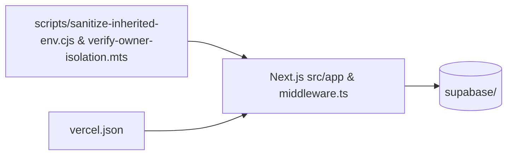

# Senior Architect Scan-Mode Note: `traject-jen-rodgers`

## 1. Synthesis (Reader Priority — Rule 19)
- **Primary Recommendation:** Add automated CI running typecheck + owner-isolation verification scripts, and clean up .scratch-probe.mts at root.
- **MCP 2 (`2026-07-28`) Status:** `No MCP surface observed`
- **Critical / High Findings:**
  - **[High | Direct] Architecture Debt — No Test Suite or CI Workflow:** No tests/ directory or .github/workflows/ CI observed; verification relies on ad-hoc scripts/verify-*.mjs and root .scratch-probe.mts.

## 2. Pass Level, Scope & Promotion Gate
- **Pass Level:** `Scan Mode` (Rule 0 default)
- **Scope:** Repository `traject-jen-rodgers` at `/Users/rig128gb/Developer/traject-jen` (`lang=TypeScript`, `private=True`)
- **Focus/Full Promotion Trigger:** Focus Mode candidate — single-tenant Next.js + Supabase + Vercel app with custom env-isolation scripts and no tests/ dir
- **Architecture Areas Classified:** Frontend/Backend (Next.js src/app, src/components, src/lib, src/middleware.ts), Database (supabase/), Infrastructure (vercel.json, scripts/sanitize-inherited-env.cjs, verify-owner-isolation.mts), Tests & Quality Gates (scripts/verify-*.mjs; no tests/ dir)

## 3. Evidence Checked & Skipped Areas
- **Evidence Files Checked (8):** `package.json`, `vercel.json`, `tsconfig.json`, `.env.example`, `README.md`, `CLAUDE.md`, `src/`, `scripts/`
- **Root Entries:** 27 items | **Last Commit:** `f0eb704 2026-09-08 16:36:09 -0600 fix(people): scope hydrated jobs to current owner` | **Dirty Files:** `2`
- **Workflows:** Not observed
- **MCP Files:** Not observed
- **Skipped Areas (Scan-Mode Budget):** Deep line-by-line module bodies, runtime execution, and external service probes (not executed in read-only Scan Mode).

## 4. Confirmed Facts (`Direct`)
- Local checkout exists at `/Users/rig128gb/Developer/traject-jen` with 27 top-level entries.
- Build/package manifests observed: `package.json`, `vercel.json`, `tsconfig.json`, `.env.example`.
- Top-level code/tool directories observed: `src/`, `scripts/`.
- Test directories observed: Not observed.
- MCP 2 (`2026-07-28`) status: `No MCP surface observed`.

## 5. Inferences & Assumptions (`Inferred` / `Assumed`)
- Inferred: scripts/sanitize-inherited-env.cjs prevents host env vars from leaking into Jennifer's single-tenant runtime.

## 6. System Map (Mermaid)

## 7. Findings (Debt, Separation of Concerns, Convention Drift, Flow Conflicts)
- **[High | Direct] Architecture Debt — No Test Suite or CI Workflow**
  - *Evidence:* No tests/ directory or .github/workflows/ CI observed; verification relies on ad-hoc scripts/verify-*.mjs and root .scratch-probe.mts.
  - *Impact & Proposed Smallest Safe Correction:* Owner-isolation regressions in a personal job-search app would not be caught automatically; proposed: add CI running typecheck + verify-owner-isolation.mts.
- **[Low | Direct] Convention Drift — Scratch Probe & Local Env Artifacts at Root**
  - *Evidence:* .scratch-probe.mts and .env.local exist at root alongside STATUS.md/BUILD-STATUS-2026-08-17.md.
  - *Impact & Proposed Smallest Safe Correction:* Clutters root; proposed: remove .scratch-probe.mts.

## 8. Open Questions, Risks & Safe Next Actions
- **Open Questions:** Is ADS-DORMANT.md still accurate or are ads active?
- **Risks:** .env.local on disk requires ensuring .gitignore covers it.
- **Safe Next Actions (Proposed, Read-Only Until Approved):**
  - Remove .scratch-probe.mts.
  - Run scripts/verify-owner-isolation.mts to confirm isolation holds.

## 9. Step-8 Validation Gate
1. **Claim traceability:** Yes — every file path, manifest, workflow, test directory, and MCP 2 status (`No MCP surface observed`) traces directly to inspected local files at `/Users/rig128gb/Developer/traject-jen`; inferences are explicitly labeled `Inferred`.
2. **Scope alignment:** Yes — bounded strictly to Scan Mode (Rule 0) read-only inspection of this single repository; no files inside the target repository were modified.
3. **Handoff readiness:** Yes — open questions, risks, and proposed smallest safe next actions are explicitly listed (or marked `None identified`).
