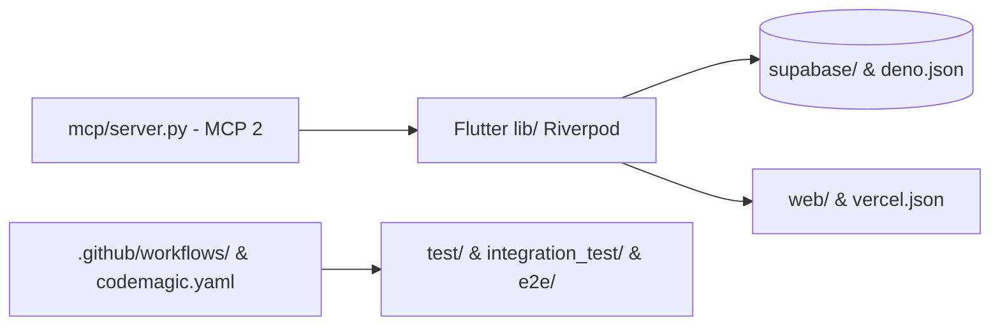

# Senior Architect Scan-Mode Note: `transformfit-flutter`

## 1. Synthesis (Reader Priority — Rule 19)
- **Primary Recommendation:** Archive or consolidate the 25+ root-level status/audit markdown files under docs/ so root stays focused on Flutter, Supabase, and release configs.
- **MCP 2 (`2026-07-28`) Status:** `Strict MCP 2`
- **Critical / High Findings:**
  - **[High | Direct] Architecture Debt — Root Documentation & Artifact Proliferation:** 45 root files and 45 root dirs include 20+ overlapping status/spec docs (STATUS.md, MISSION_STATUS.md, BUILD-STATUS.md, PLAN.md, UX_UI_AUDIT_REPORT.md, etc.) plus crash_logs/, artifacts/, outputs/.

## 2. Pass Level, Scope & Promotion Gate
- **Pass Level:** `Scan Mode` (Rule 0 default)
- **Scope:** Repository `transformfit-flutter` at `/Users/rig128gb/Developer/transformfit-flutter` (`lang=Dart`, `private=True`)
- **Focus/Full Promotion Trigger:** Full Mode candidate — 92 root dirs/files, Flutter multi-platform (web/ios/macos/android), Supabase/Deno, Codemagic, visual gates, and Strict MCP 2
- **Architecture Areas Classified:** Frontend (Flutter lib/, web/, ios/, macos/, android/), Backend/Database (supabase/, deno.json, hosting/), AI/Coaching (lib/engine/, tools/visual_reference_gate.py), External Services/MCP (mcp/server.py), Infrastructure (.github/workflows/ 5 workflows, codemagic.yaml, vercel.json, scripts/), Tests & Quality Gates (test/, integration_test/, e2e/, tests/)

## 3. Evidence Checked & Skipped Areas
- **Evidence Files Checked (16):** `pubspec.yaml`, `vercel.json`, `README.md`, `AGENTS.md`, `.github/workflows/acceptance-evidence.yml`, `.github/workflows/build.yml`, `.github/workflows/ci.yml`, `.github/workflows/e2e-tiers.yml`, `.github/workflows/rig-lattice.yml`, `tests/`, `test/`, `mcp/server.py`, `lib/`, `scripts/`, `web/`, `tools/`
- **Root Entries:** 92 items | **Last Commit:** `b87ee430 2026-11-15 09:37:24 -0700 docs: gate report for iOS 2035 release (tf-appstore-release-20261027)` | **Dirty Files:** `4`
- **Workflows:** `acceptance-evidence.yml`, `build.yml`, `ci.yml`, `e2e-tiers.yml`, `rig-lattice.yml`
- **MCP Files:** `mcp/server.py`
- **Skipped Areas (Scan-Mode Budget):** Deep line-by-line module bodies, runtime execution, and external service probes (not executed in read-only Scan Mode).

## 4. Confirmed Facts (`Direct`)
- Local checkout exists at `/Users/rig128gb/Developer/transformfit-flutter` with 92 top-level entries.
- Build/package manifests observed: `pubspec.yaml`, `vercel.json`.
- Top-level code/tool directories observed: `lib/`, `scripts/`, `web/`, `tools/`.
- Test directories observed: `tests/`, `test/`.
- MCP 2 (`2026-07-28`) status: `Strict MCP 2`.

## 5. Inferences & Assumptions (`Inferred` / `Assumed`)
- Inferred: Strict MCP 2 (2026-07-28) server at mcp/server.py exposes verified build/certification state rather than live app runtime.

## 6. System Map (Mermaid)

## 7. Findings (Debt, Separation of Concerns, Convention Drift, Flow Conflicts)
- **[High | Direct] Architecture Debt — Root Documentation & Artifact Proliferation**
  - *Evidence:* 45 root files and 45 root dirs include 20+ overlapping status/spec docs (STATUS.md, MISSION_STATUS.md, BUILD-STATUS.md, PLAN.md, UX_UI_AUDIT_REPORT.md, etc.) plus crash_logs/, artifacts/, outputs/.
  - *Impact & Proposed Smallest Safe Correction:* Hard for engineers/agents to identify canonical state vs. historical audits; proposed: move dated reports into docs/archive/ and keep one canonical STATUS.md.
- **[Medium | Direct] Separation of Concerns — Multiple Test Roots**
  - *Evidence:* Tests are split across test/, integration_test/, e2e/, and tests/ (Python/SQL contract tests).
  - *Impact & Proposed Smallest Safe Correction:* Requires running multiple test runners to verify full behavior; proposed: document unified test matrix in README.md.

## 8. Open Questions, Risks & Safe Next Actions
- **Open Questions:** Which of the 3 UX/Design specs (DESIGN_SYSTEM_V4.md, TRANSFORMFIT_DESIGN_SYSTEM_SPEC.md, UI_REDESIGN_SPEC.md) is authoritative?
- **Risks:** 4 uncommitted files in local checkout.
- **Safe Next Actions (Proposed, Read-Only Until Approved):**
  - Inspect the 4 dirty files.
  - Consolidate root audit markdowns into docs/archive/ (requires approval).

## 9. Step-8 Validation Gate
1. **Claim traceability:** Yes — every file path, manifest, workflow, test directory, and MCP 2 status (`Strict MCP 2`) traces directly to inspected local files at `/Users/rig128gb/Developer/transformfit-flutter`; inferences are explicitly labeled `Inferred`.
2. **Scope alignment:** Yes — bounded strictly to Scan Mode (Rule 0) read-only inspection of this single repository; no files inside the target repository were modified.
3. **Handoff readiness:** Yes — open questions, risks, and proposed smallest safe next actions are explicitly listed (or marked `None identified`).
