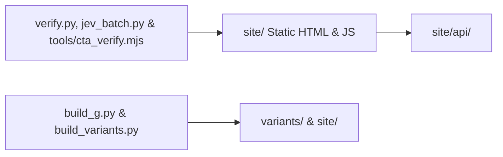

# Senior Architect Scan-Mode Note: `transformfit-landing`

## 1. Synthesis (Reader Priority — Rule 19)
- **Primary Recommendation:** Add a root package.json or Makefile unifying tools/cta_verify.mjs and verify.py, and remove root screenshot/output artifacts (MIKE-IPHONE-SCREENSHOT-20261027.jpg, verify.out).
- **MCP 2 (`2026-07-28`) Status:** `No MCP surface observed`
- **Critical / High Findings:** None identified.

## 2. Pass Level, Scope & Promotion Gate
- **Pass Level:** `Scan Mode` (Rule 0 default)
- **Scope:** Repository `transformfit-landing` at `/Users/rig128gb/rig-builds/transformfit-landing-fix` (`lang=HTML`, `private=True`)
- **Focus/Full Promotion Trigger:** None (static marketing site + Jev/Playwright verification scripts)
- **Architecture Areas Classified:** Frontend (site/*.html, chat.js, fighter.css, variants/), Tests & Quality Gates (verify.py, jev_batch.py, tools/cta_verify.mjs, flow.mjs, shots.mjs), Infrastructure (site/api/, build_g.py, build_variants.py)

## 3. Evidence Checked & Skipped Areas
- **Evidence Files Checked (1):** `tools/`
- **Root Entries:** 22 items | **Last Commit:** `ae85882 2026-11-17 21:32:53 -0700 index: restore the two approved production copy sentences that rode the analytics commit (store-launch v2 wording returns with its own exact-text approval; captured for the lane in rig-builds/heycatch-golive/state/tf-riding-copy.diff.txt)` | **Dirty Files:** `1`
- **Workflows:** Not observed
- **MCP Files:** Not observed
- **Skipped Areas (Scan-Mode Budget):** Deep line-by-line module bodies, runtime execution, and external service probes (not executed in read-only Scan Mode).

## 4. Confirmed Facts (`Direct`)
- Local checkout exists at `/Users/rig128gb/rig-builds/transformfit-landing-fix` with 22 top-level entries.
- Build/package manifests observed: Not observed.
- Top-level code/tool directories observed: `tools/`.
- Test directories observed: Not observed.
- MCP 2 (`2026-07-28`) status: `No MCP surface observed`.

## 5. Inferences & Assumptions (`Inferred` / `Assumed`)
- Inferred: Deployed to Vercel (transformfit.app) from site/.

## 6. System Map (Mermaid)

## 7. Findings (Debt, Separation of Concerns, Convention Drift, Flow Conflicts)
- **[Medium | Direct] Architecture Debt — Unpackaged Build/Verify Scripts & Root Artifacts**
  - *Evidence:* package.json lives inside tools/ rather than root, while root holds Python scripts (build_g.py, jev_batch.py, verify.py) and raw output files (verify.out, MIKE-IPHONE-SCREENSHOT-20261027.jpg).
  - *Impact & Proposed Smallest Safe Correction:* Fragile manual verification workflow with no CI; proposed: move screenshot/verify.out to evidence/ and add a root Makefile or CI check.

## 8. Open Questions, Risks & Safe Next Actions
- **Open Questions:** Are variants/ still used or superseded by live site/ index?
- **Risks:** 1 dirty file in local checkout; copy changes require exact-text Gate-D approval.
- **Safe Next Actions (Proposed, Read-Only Until Approved):**
  - Check the 1 dirty file.
  - Run tools/cta_verify.mjs and verify.py before any deploy.

## 9. Step-8 Validation Gate
1. **Claim traceability:** Yes — every file path, manifest, workflow, test directory, and MCP 2 status (`No MCP surface observed`) traces directly to inspected local files at `/Users/rig128gb/rig-builds/transformfit-landing-fix`; inferences are explicitly labeled `Inferred`.
2. **Scope alignment:** Yes — bounded strictly to Scan Mode (Rule 0) read-only inspection of this single repository; no files inside the target repository were modified.
3. **Handoff readiness:** Yes — open questions, risks, and proposed smallest safe next actions are explicitly listed (or marked `None identified`).
