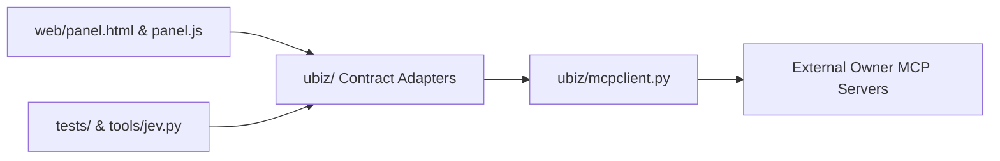

# Senior Architect Scan-Mode Note: `unified-business-repo`

## 1. Synthesis (Reader Priority — Rule 19)
- **Primary Recommendation:** Verify ubiz/mcpclient.py handles Strict MCP 2 (2026-07-28) server responses as upstream owners upgrade from MCP v1.
- **MCP 2 (`2026-07-28`) Status:** `No MCP surface observed`
- **Critical / High Findings:** None identified.

## 2. Pass Level, Scope & Promotion Gate
- **Pass Level:** `Scan Mode` (Rule 0 default)
- **Scope:** Repository `unified-business-repo` at `/Users/rig128gb/rig-builds/unified-business-repo` (`lang=Python`, `private=True`)
- **Focus/Full Promotion Trigger:** None (clean P7 adapter service; 0 dirty files)
- **Architecture Areas Classified:** Frontend (web/panel.html, panel.js, panel.css), Backend/Adapters (ubiz/, ubiz/mcpclient.py), Infrastructure (launchd/, bundle/), Tests & Quality Gates (tests/ with 6 test modules, tools/jev.py, cdp.mjs)

## 3. Evidence Checked & Skipped Areas
- **Evidence Files Checked (5):** `pyproject.toml`, `README.md`, `tests/`, `web/`, `tools/`
- **Root Entries:** 18 items | **Last Commit:** `f694a6b 2026-11-09 13:57:13 -0600 chore: checkpoint before github consolidation 2026-11-09` | **Dirty Files:** `0`
- **Workflows:** Not observed
- **MCP Files:** Not observed
- **Skipped Areas (Scan-Mode Budget):** Deep line-by-line module bodies, runtime execution, and external service probes (not executed in read-only Scan Mode).

## 4. Confirmed Facts (`Direct`)
- Local checkout exists at `/Users/rig128gb/rig-builds/unified-business-repo` with 18 top-level entries.
- Build/package manifests observed: `pyproject.toml`.
- Top-level code/tool directories observed: `web/`, `tools/`.
- Test directories observed: `tests/`.
- MCP 2 (`2026-07-28`) status: `No MCP surface observed`.

## 5. Inferences & Assumptions (`Inferred` / `Assumed`)
- Inferred: Pure consumer/adapter layer; does not host its own MCP server.

## 6. System Map (Mermaid)

## 7. Findings (Debt, Separation of Concerns, Convention Drift, Flow Conflicts)
- **[Medium | Inferred] Flow Conflict Risk — Upstream MCP v1 vs. v2 Compatibility**
  - *Evidence:* ubiz/mcpclient.py spawns owner stdio MCP servers assuming v1 call shapes.
  - *Impact & Proposed Smallest Safe Correction:* May break as downstream owner servers upgrade to Strict MCP 2 (2026-07-28); proposed: test mcpclient.py against Strict MCP 2 responses (Verify first: Yes).

## 8. Open Questions, Risks & Safe Next Actions
- **Open Questions:** Which upstream owner MCP servers does ubiz/mcpclient.py spawn in production?
- **Risks:** No CI workflow observed; relies on local pytest.
- **Safe Next Actions (Proposed, Read-Only Until Approved):**
  - Run pytest on tests/.
  - Audit ubiz/mcpclient.py protocolVersion handling.

## 9. Step-8 Validation Gate
1. **Claim traceability:** Yes — every file path, manifest, workflow, test directory, and MCP 2 status (`No MCP surface observed`) traces directly to inspected local files at `/Users/rig128gb/rig-builds/unified-business-repo`; inferences are explicitly labeled `Inferred`.
2. **Scope alignment:** Yes — bounded strictly to Scan Mode (Rule 0) read-only inspection of this single repository; no files inside the target repository were modified.
3. **Handoff readiness:** Yes — open questions, risks, and proposed smallest safe next actions are explicitly listed (or marked `None identified`).
