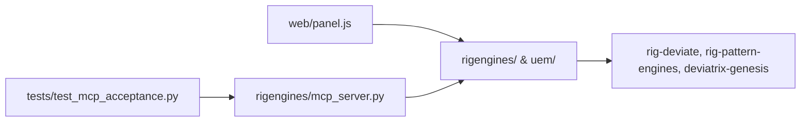

# Senior Architect Scan-Mode Note: `unified-engines-repo`

## 1. Synthesis (Reader Priority — Rule 19)
- **Primary Recommendation:** Upgrade pyproject.toml (`mcp>=1.2,<2` pin) and rigengines/mcp_server.py (FastMCP) to Strict MCP 2 (2026-07-28), and fix the hardcoded .mcp.json path pointing to unified-engines-media.
- **MCP 2 (`2026-07-28`) Status:** `Legacy MCP v1 (upgrade needed)`
- **Critical / High Findings:**
  - **[High | Direct] MCP 2 Compliance — Pinned Legacy MCP v1:** pyproject.toml pins `mcp>=1.2,<2` and rigengines/mcp_server.py uses FastMCP v1 without 2026-07-28.

## 2. Pass Level, Scope & Promotion Gate
- **Pass Level:** `Scan Mode` (Rule 0 default)
- **Scope:** Repository `unified-engines-repo` at `/Users/rig128gb/rig-builds/unified-engines-repo` (`lang=Python`, `private=True`)
- **Focus/Full Promotion Trigger:** None (clean P3 engines facade; 0 dirty files)
- **Architecture Areas Classified:** Frontend (web/index.html, panel.js), Backend/CLI (rigengines/, uem/), External Services/MCP (.mcp.json, rigengines/mcp_server.py, tools/mcp_chat.py), Infrastructure (launchd/), Tests & Quality Gates (tests/ with 10 test modules)

## 3. Evidence Checked & Skipped Areas
- **Evidence Files Checked (6):** `pyproject.toml`, `README.md`, `tests/`, `.mcp.json`, `web/`, `tools/`
- **Root Entries:** 22 items | **Last Commit:** `7d28d99 2026-11-09 19:22:59 -0600 Initial import: unified-engines-repo (consolidation 2026-11-09)` | **Dirty Files:** `0`
- **Workflows:** Not observed
- **MCP Files:** `.mcp.json`
- **Skipped Areas (Scan-Mode Budget):** Deep line-by-line module bodies, runtime execution, and external service probes (not executed in read-only Scan Mode).

## 4. Confirmed Facts (`Direct`)
- Local checkout exists at `/Users/rig128gb/rig-builds/unified-engines-repo` with 22 top-level entries.
- Build/package manifests observed: `pyproject.toml`.
- Top-level code/tool directories observed: `web/`, `tools/`.
- Test directories observed: `tests/`.
- MCP 2 (`2026-07-28`) status: `Legacy MCP v1 (upgrade needed)`.

## 5. Inferences & Assumptions (`Inferred` / `Assumed`)
- Inferred: rigengines/ is the canonical facade while uem/ holds legacy or media engine helpers.

## 6. System Map (Mermaid)

## 7. Findings (Debt, Separation of Concerns, Convention Drift, Flow Conflicts)
- **[High | Direct] MCP 2 Compliance — Pinned Legacy MCP v1**
  - *Evidence:* pyproject.toml pins `mcp>=1.2,<2` and rigengines/mcp_server.py uses FastMCP v1 without 2026-07-28.
  - *Impact & Proposed Smallest Safe Correction:* Blocks Strict MCP 2 fleet compliance; proposed: upgrade to Strict MCP 2 (2026-07-28).
- **[Medium | Direct] Convention Drift — Stale .mcp.json Path & Backup HTML**
  - *Evidence:* .mcp.json points to `/Users/rig128gb/rig-builds/unified-engines-media/.venv/bin/python` instead of unified-engines-repo, and web/index.html.pre-theme-parity.bak remains.
  - *Impact & Proposed Smallest Safe Correction:* Local MCP launch fails or hits wrong directory; proposed: update .mcp.json path and remove .bak file.

## 8. Open Questions, Risks & Safe Next Actions
- **Open Questions:** Is unified-engines-media still active or merged into unified-engines-repo?
- **Risks:** Hardcoded absolute path in .mcp.json breaks portability.
- **Safe Next Actions (Proposed, Read-Only Until Approved):**
  - Fix .mcp.json path.
  - Upgrade rigengines/mcp_server.py to Strict MCP 2 (requires approval).

## 9. Step-8 Validation Gate
1. **Claim traceability:** Yes — every file path, manifest, workflow, test directory, and MCP 2 status (`Legacy MCP v1 (upgrade needed)`) traces directly to inspected local files at `/Users/rig128gb/rig-builds/unified-engines-repo`; inferences are explicitly labeled `Inferred`.
2. **Scope alignment:** Yes — bounded strictly to Scan Mode (Rule 0) read-only inspection of this single repository; no files inside the target repository were modified.
3. **Handoff readiness:** Yes — open questions, risks, and proposed smallest safe next actions are explicitly listed (or marked `None identified`).
