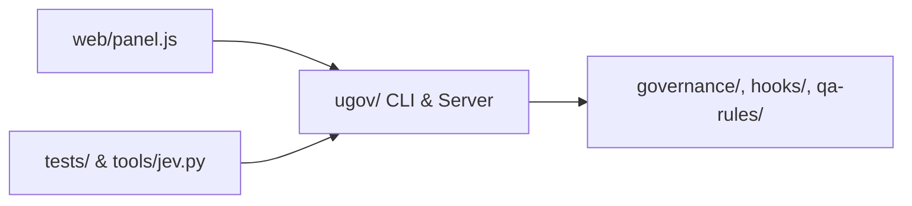

# Senior Architect Scan-Mode Note: `unified-governance-repo`

## 1. Synthesis (Reader Priority — Rule 19)
- **Primary Recommendation:** Add a CI workflow to run the 8 pytest modules in tests/ automatically on push.
- **MCP 2 (`2026-07-28`) Status:** `No MCP surface observed`
- **Critical / High Findings:** None identified.

## 2. Pass Level, Scope & Promotion Gate
- **Pass Level:** `Scan Mode` (Rule 0 default)
- **Scope:** Repository `unified-governance-repo` at `/Users/rig128gb/rig-builds/unified-governance-repo` (`lang=Python`, `private=True`)
- **Focus/Full Promotion Trigger:** None (clean P9 governance service; 0 dirty files)
- **Architecture Areas Classified:** Frontend (web/panel.html, panel.js), Backend/CLI (ugov/, governance/, hooks/, qa-rules/), Infrastructure (launchd/, bundle/), Tests & Quality Gates (tests/ with 8 test modules)

## 3. Evidence Checked & Skipped Areas
- **Evidence Files Checked (5):** `pyproject.toml`, `README.md`, `tests/`, `web/`, `tools/`
- **Root Entries:** 19 items | **Last Commit:** `6ab1695 2026-11-09 13:57:19 -0600 chore: checkpoint before github consolidation 2026-11-09` | **Dirty Files:** `0`
- **Workflows:** Not observed
- **MCP Files:** Not observed
- **Skipped Areas (Scan-Mode Budget):** Deep line-by-line module bodies, runtime execution, and external service probes (not executed in read-only Scan Mode).

## 4. Confirmed Facts (`Direct`)
- Local checkout exists at `/Users/rig128gb/rig-builds/unified-governance-repo` with 19 top-level entries.
- Build/package manifests observed: `pyproject.toml`.
- Top-level code/tool directories observed: `web/`, `tools/`.
- Test directories observed: `tests/`.
- MCP 2 (`2026-07-28`) status: `No MCP surface observed`.

## 5. Inferences & Assumptions (`Inferred` / `Assumed`)
- Inferred: P9 governance + QA overlay running under launchd with uv CPython 3.11.

## 6. System Map (Mermaid)

## 7. Findings (Debt, Separation of Concerns, Convention Drift, Flow Conflicts)
- **[Low | Direct] Architecture Debt — No Automated CI**
  - *Evidence:* No .github/workflows/ CI observed for the 8 pytest modules.
  - *Impact & Proposed Smallest Safe Correction:* Relies on manual test runs; proposed: add CI workflow.

## 8. Open Questions, Risks & Safe Next Actions
- **Open Questions:** None identified
- **Risks:** None identified
- **Safe Next Actions (Proposed, Read-Only Until Approved):**
  - Run pytest on tests/ to confirm baseline.

## 9. Step-8 Validation Gate
1. **Claim traceability:** Yes — every file path, manifest, workflow, test directory, and MCP 2 status (`No MCP surface observed`) traces directly to inspected local files at `/Users/rig128gb/rig-builds/unified-governance-repo`; inferences are explicitly labeled `Inferred`.
2. **Scope alignment:** Yes — bounded strictly to Scan Mode (Rule 0) read-only inspection of this single repository; no files inside the target repository were modified.
3. **Handoff readiness:** Yes — open questions, risks, and proposed smallest safe next actions are explicitly listed (or marked `None identified`).
