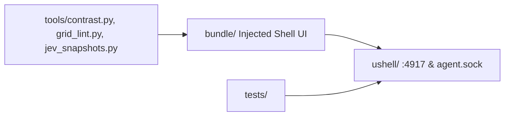

# Senior Architect Scan-Mode Note: `unified-shell-repo`

## 1. Synthesis (Reader Priority — Rule 19)
- **Primary Recommendation:** Triage the 17 dirty working-tree files and remove .pre-theme-sync-20261030-052704/ and .bak files in tests/.
- **MCP 2 (`2026-07-28`) Status:** `No MCP surface observed`
- **Critical / High Findings:** None identified.

## 2. Pass Level, Scope & Promotion Gate
- **Pass Level:** `Scan Mode` (Rule 0 default)
- **Scope:** Repository `unified-shell-repo` at `/Users/rig128gb/rig-builds/unified-shell-repo` (`lang=JavaScript`, `private=True`)
- **Focus/Full Promotion Trigger:** Focus Mode candidate — 17 dirty files and .pre-theme-sync backup dirs
- **Architecture Areas Classified:** Backend/CLI (ushell/ loopback :4917 + agent.sock), Frontend/Bundle (bundle/, design/), Infrastructure (launchd/), Tests & Quality Gates (tests/ with 7 test modules, tools/contrast.py, grid_lint.py)

## 3. Evidence Checked & Skipped Areas
- **Evidence Files Checked (3):** `README.md`, `tests/`, `tools/`
- **Root Entries:** 14 items | **Last Commit:** `0ca58b6 2026-11-09 13:57:25 -0600 chore: checkpoint before github consolidation 2026-11-09` | **Dirty Files:** `17`
- **Workflows:** Not observed
- **MCP Files:** Not observed
- **Skipped Areas (Scan-Mode Budget):** Deep line-by-line module bodies, runtime execution, and external service probes (not executed in read-only Scan Mode).

## 4. Confirmed Facts (`Direct`)
- Local checkout exists at `/Users/rig128gb/rig-builds/unified-shell-repo` with 14 top-level entries.
- Build/package manifests observed: Not observed.
- Top-level code/tool directories observed: `tools/`.
- Test directories observed: `tests/`.
- MCP 2 (`2026-07-28`) status: `No MCP surface observed`.

## 5. Inferences & Assumptions (`Inferred` / `Assumed`)
- Inferred: P1 Unified Aside shell serving loopback :4917 and agent.sock.

## 6. System Map (Mermaid)

## 7. Findings (Debt, Separation of Concerns, Convention Drift, Flow Conflicts)
- **[Medium | Direct] Architecture Debt — Dirty Working Tree & Backup Artifacts**
  - *Evidence:* 17 uncommitted files, .pre-theme-sync-20261030-052704/ at root, and .bak files inside tests/.
  - *Impact & Proposed Smallest Safe Correction:* Obscures canonical theme state; proposed: commit or revert dirty edits and prune backup files.
- **[Low | Direct] Architecture Debt — Missing pyproject.toml**
  - *Evidence:* Python package ushell/ and pytest suite lack a root pyproject.toml.
  - *Impact & Proposed Smallest Safe Correction:* Depends on system /usr/bin/python3 environment; proposed: add pyproject.toml.

## 8. Open Questions, Risks & Safe Next Actions
- **Open Questions:** Are the 17 dirty files active theme work or leftover test artifacts?
- **Risks:** Uncommitted changes to ushell could affect Aside shell stability.
- **Safe Next Actions (Proposed, Read-Only Until Approved):**
  - Inspect git status and run pytest on tests/.

## 9. Step-8 Validation Gate
1. **Claim traceability:** Yes — every file path, manifest, workflow, test directory, and MCP 2 status (`No MCP surface observed`) traces directly to inspected local files at `/Users/rig128gb/rig-builds/unified-shell-repo`; inferences are explicitly labeled `Inferred`.
2. **Scope alignment:** Yes — bounded strictly to Scan Mode (Rule 0) read-only inspection of this single repository; no files inside the target repository were modified.
3. **Handoff readiness:** Yes — open questions, risks, and proposed smallest safe next actions are explicitly listed (or marked `None identified`).
