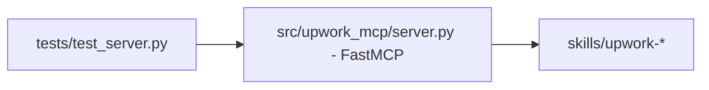

# Senior Architect Scan-Mode Note: `upwork-mcp`

## 1. Synthesis (Reader Priority — Rule 19)
- **Primary Recommendation:** Upgrade pyproject.toml (`mcp>=1.2,<2`) and src/upwork_mcp/server.py (FastMCP) to Strict MCP 2 (2026-07-28) when ready to drop v1 pin.
- **MCP 2 (`2026-07-28`) Status:** `Legacy MCP v1 (upgrade needed)`
- **Critical / High Findings:**
  - **[High | Direct] MCP 2 Compliance — Explicit MCP v1 Pin:** pyproject.toml explicitly pins `mcp>=1.2,<2` (commit 68d46cd notes 2.x dropped mcp.server.fastmcp).

## 2. Pass Level, Scope & Promotion Gate
- **Pass Level:** `Scan Mode` (Rule 0 default)
- **Scope:** Repository `upwork-mcp` at `/Users/rig128gb/Developer/upwork-mcp` (`lang=Python`, `private=True`)
- **Focus/Full Promotion Trigger:** None (clean inward-facing FastMCP server; 0 dirty files)
- **Architecture Areas Classified:** Backend/MCP (src/upwork_mcp/server.py), AI/Skills (skills/upwork-*), Tests & Quality Gates (tests/test_server.py)

## 3. Evidence Checked & Skipped Areas
- **Evidence Files Checked (5):** `pyproject.toml`, `README.md`, `tests/`, `src/`, `skills/`
- **Root Entries:** 9 items | **Last Commit:** `68d46cd 2026-10-30 05:38:38 -0500 pin mcp<2 (2.x dropped mcp.server.fastmcp); macOS sandbox note` | **Dirty Files:** `0`
- **Workflows:** Not observed
- **MCP Files:** Not observed
- **Skipped Areas (Scan-Mode Budget):** Deep line-by-line module bodies, runtime execution, and external service probes (not executed in read-only Scan Mode).

## 4. Confirmed Facts (`Direct`)
- Local checkout exists at `/Users/rig128gb/Developer/upwork-mcp` with 9 top-level entries.
- Build/package manifests observed: `pyproject.toml`.
- Top-level code/tool directories observed: `src/`, `skills/`.
- Test directories observed: `tests/`.
- MCP 2 (`2026-07-28`) status: `Legacy MCP v1 (upgrade needed)`.

## 5. Inferences & Assumptions (`Inferred` / `Assumed`)
- Inferred: Intentionally inward-facing only (no outward proposal submit/hire tools).

## 6. System Map (Mermaid)

## 7. Findings (Debt, Separation of Concerns, Convention Drift, Flow Conflicts)
- **[High | Direct] MCP 2 Compliance — Explicit MCP v1 Pin**
  - *Evidence:* pyproject.toml explicitly pins `mcp>=1.2,<2` (commit 68d46cd notes 2.x dropped mcp.server.fastmcp).
  - *Impact & Proposed Smallest Safe Correction:* Blocks Strict MCP 2 (2026-07-28) compliance; proposed: migrate server.py from mcp.server.fastmcp to Strict MCP 2.
- **[Low | Direct] Architecture Debt — No CI Workflow**
  - *Evidence:* No .github/workflows/ CI observed for tests/test_server.py.
  - *Impact & Proposed Smallest Safe Correction:* Manual test execution only; proposed: add pytest CI.

## 8. Open Questions, Risks & Safe Next Actions
- **Open Questions:** None identified
- **Risks:** macOS sandbox restrictions noted in commit 68d46cd.
- **Safe Next Actions (Proposed, Read-Only Until Approved):**
  - Run pytest on tests/test_server.py.
  - Plan FastMCP -> Strict MCP 2 migration (requires approval).

## 9. Step-8 Validation Gate
1. **Claim traceability:** Yes — every file path, manifest, workflow, test directory, and MCP 2 status (`Legacy MCP v1 (upgrade needed)`) traces directly to inspected local files at `/Users/rig128gb/Developer/upwork-mcp`; inferences are explicitly labeled `Inferred`.
2. **Scope alignment:** Yes — bounded strictly to Scan Mode (Rule 0) read-only inspection of this single repository; no files inside the target repository were modified.
3. **Handoff readiness:** Yes — open questions, risks, and proposed smallest safe next actions are explicitly listed (or marked `None identified`).
