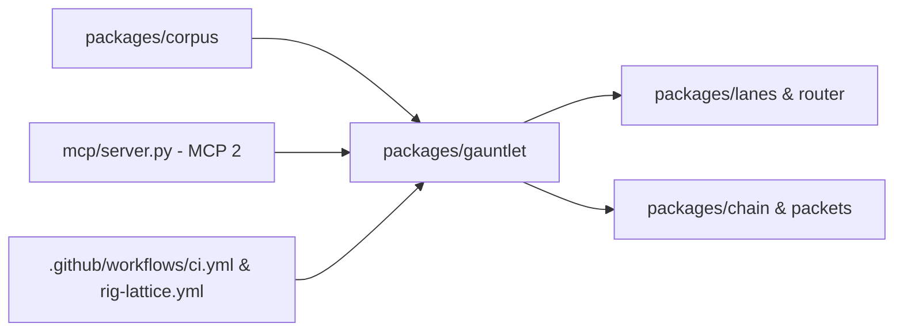

# Senior Architect Scan-Mode Note: `vibe-production-gauntlet`

## 1. Synthesis (Reader Priority — Rule 19)
- **Primary Recommendation:** Add explicit package-level test coverage checks alongside `pnpm -r build && typecheck` and triage the 3 dirty local files.
- **MCP 2 (`2026-07-28`) Status:** `Strict MCP 2`
- **Critical / High Findings:** None identified.

## 2. Pass Level, Scope & Promotion Gate
- **Pass Level:** `Scan Mode` (Rule 0 default)
- **Scope:** Repository `vibe-production-gauntlet` at `/Users/rig128gb/Developer/vibe-production-gauntlet` (`lang=TypeScript`, `private=True`)
- **Focus/Full Promotion Trigger:** Focus Mode candidate — 6-package TypeScript pnpm workspace + Python Strict MCP 2 + 21 root governance/proof files
- **Architecture Areas Classified:** Backend/Libraries (packages/chain, corpus, gauntlet, lanes, packets, router), External Services/MCP (mcp/server.py), Infrastructure (pnpm-workspace.yaml, vitest.config.ts, .github/workflows/ci.yml, rig-lattice.yml, weekly-evolution.yml), Tests & Quality Gates (vitest, scripts/check-coverage-refs.mjs, GATES.md)

## 3. Evidence Checked & Skipped Areas
- **Evidence Files Checked (9):** `package.json`, `README.md`, `AGENTS.md`, `.github/workflows/ci.yml`, `.github/workflows/rig-lattice.yml`, `.github/workflows/weekly-evolution.yml`, `mcp/server.py`, `packages/`, `scripts/`
- **Root Entries:** 33 items | **Last Commit:** `a0ff168 2026-10-10 17:41:23 -0600 Merge pull request #1 from mrodgersjs-web/fix/rig-lattice-skip-until-published` | **Dirty Files:** `3`
- **Workflows:** `ci.yml`, `rig-lattice.yml`, `weekly-evolution.yml`
- **MCP Files:** `mcp/server.py`
- **Skipped Areas (Scan-Mode Budget):** Deep line-by-line module bodies, runtime execution, and external service probes (not executed in read-only Scan Mode).

## 4. Confirmed Facts (`Direct`)
- Local checkout exists at `/Users/rig128gb/Developer/vibe-production-gauntlet` with 33 top-level entries.
- Build/package manifests observed: `package.json`.
- Top-level code/tool directories observed: `packages/`, `scripts/`.
- Test directories observed: Not observed.
- MCP 2 (`2026-07-28`) status: `Strict MCP 2`.

## 5. Inferences & Assumptions (`Inferred` / `Assumed`)
- Inferred: Well-structured pnpm monorepo with Strict MCP 2 (2026-07-28) stdlib server and Lattice CI.

## 6. System Map (Mermaid)

## 7. Findings (Debt, Separation of Concerns, Convention Drift, Flow Conflicts)
- **[Low | Direct] Convention Drift — Uncommitted Local Changes**
  - *Evidence:* git status shows 3 dirty files.
  - *Impact & Proposed Smallest Safe Correction:* Minor drift against origin/main; proposed: inspect and commit or clean.
- **[Low | Direct] Architecture Debt — Root Artifact Concentration**
  - *Evidence:* 21 root files mix workspace config with CAPSTONE-REPORT.html, CAPSTONE-MATRIX.json, RELEASE-PROOF.json, and corpus-report.json.
  - *Impact & Proposed Smallest Safe Correction:* Clutters workspace root; proposed: move generated reports/proofs under proof/ or reports/.

## 8. Open Questions, Risks & Safe Next Actions
- **Open Questions:** None identified
- **Risks:** None significant.
- **Safe Next Actions (Proposed, Read-Only Until Approved):**
  - Inspect the 3 dirty files.
  - Run `pnpm -r typecheck` and vitest.

## 9. Step-8 Validation Gate
1. **Claim traceability:** Yes — every file path, manifest, workflow, test directory, and MCP 2 status (`Strict MCP 2`) traces directly to inspected local files at `/Users/rig128gb/Developer/vibe-production-gauntlet`; inferences are explicitly labeled `Inferred`.
2. **Scope alignment:** Yes — bounded strictly to Scan Mode (Rule 0) read-only inspection of this single repository; no files inside the target repository were modified.
3. **Handoff readiness:** Yes — open questions, risks, and proposed smallest safe next actions are explicitly listed (or marked `None identified`).
